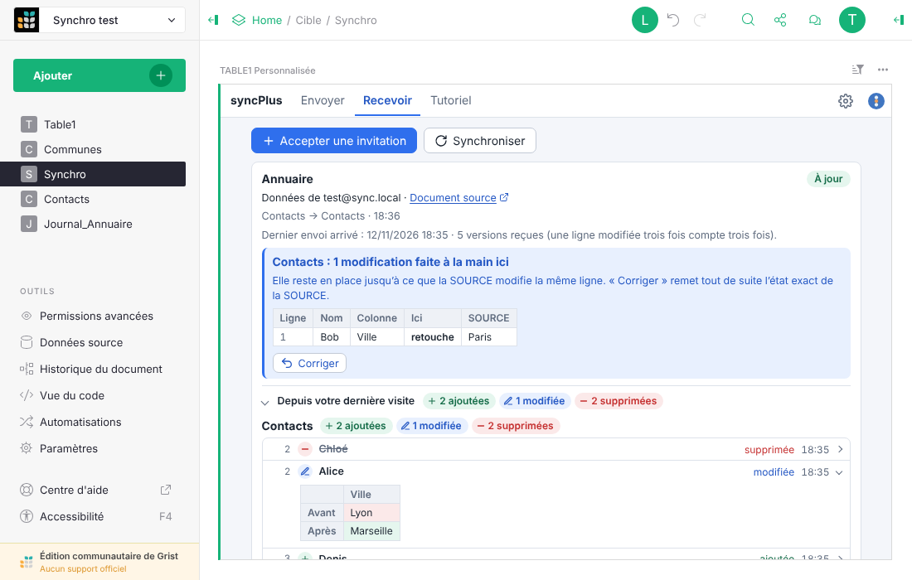
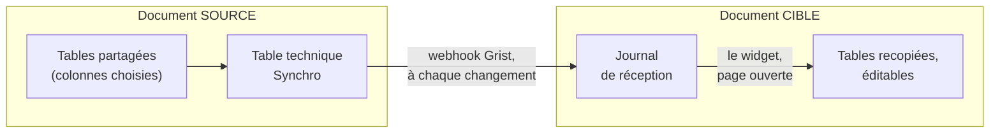
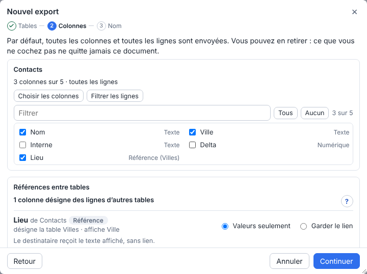
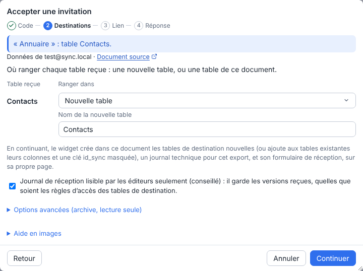
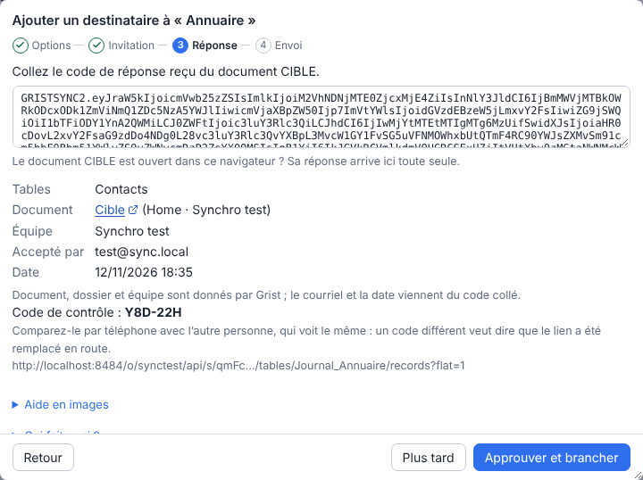
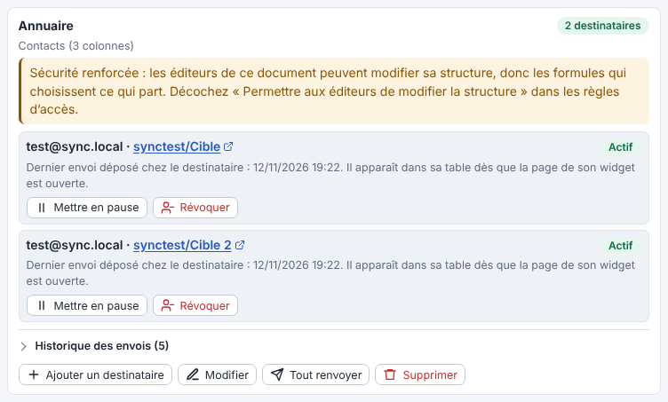
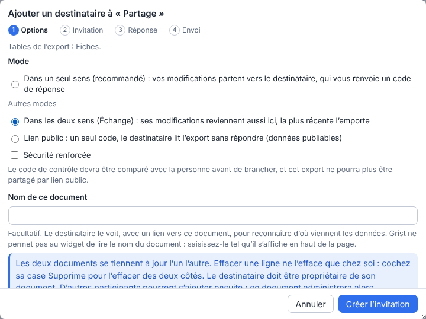

<div align="center">


# syncPlus

**Recopiez des tables d'un document Grist dans un autre, tenues à jour toutes seules.**<br>
Sans serveur à héberger, sans dépendance, et seules les colonnes que vous choisissez sortent.

**Français** · [English](README.en.md)



<sub>Version 0.19.2 · Grist 1.7.11 ou plus récent · licence GPL-3.0 · Grist Factory</sub>

</div>

## À quoi ça sert

Un service tient une table de référence dans Grist (contacts, établissements, nomenclature) et
d'autres équipes en ont besoin dans leurs propres documents. syncPlus leur en envoie une copie
qu'elles peuvent compléter, et la met à jour à chaque ajout, modification ou suppression dans
l'original.

- **Rien à héberger** : c'est Grist qui transporte les changements, même quand personne n'a le
  document ouvert.
- **Vous choisissez ce qui sort** : les tables, les colonnes et, en option, les lignes.
- **Chaque destinataire à part** : on en ajoute, on en met un en pause, on en révoque un sans
  toucher aux autres.
- **Dans les deux sens si besoin** : en mode Échange, deux documents se tiennent à jour l'un
  l'autre ; à plusieurs, un document administre, relaie entre les participants et peut garder
  leurs changements à valider ou les refuser.

## Comment ça marche



Le document qui envoie (la **SOURCE**) et celui qui reçoit (la **CIBLE**) ont chacun le widget.
Dans la SOURCE, il prépare les lignes modifiées dans une seule table technique ; un webhook de
Grist les pousse aussitôt dans le journal de la CIBLE, par un formulaire qu'elle a publié pour
cela. Dans la CIBLE, le widget contrôle ce qui arrive et le recopie dans des tables normales dès
qu'un éditeur ouvre sa page. Le détail est dans [`docs/06-architecture.md`](docs/06-architecture.md).

## Brancher une synchro en trois étapes

Deux codes à copier-coller entre les deux personnes. Ils ne contiennent aucune donnée. Si vous gérez les deux documents et les avez ouverts dans deux onglets du même navigateur, ils passent d'un onglet à l'autre d'un clic (le lien du formulaire reste à coller).

<table>
<tr>
<td width="33%" valign="top">

<br><b>1. SOURCE : créer l'export</b><br>
Choisir les tables et les colonnes, puis ajouter un destinataire. Le widget donne un
<b>code d'invitation</b>.
</td>
<td width="33%" valign="top">

<br><b>2. CIBLE : accepter l'invitation</b><br>
Coller le code, choisir où ranger chaque table, copier le lien du formulaire publié. Le widget
donne un <b>code de réponse</b>.
</td>
<td width="33%" valign="top">

<br><b>3. SOURCE : approuver</b><br>
Coller la réponse, vérifier qui a accepté, <b>Approuver et brancher</b>. Les lignes existantes
partent, puis chaque modification.
</td>
</tr>
</table>

Le pas à pas complet, capture par capture, est dans le [tutoriel](docs/04-tutoriel.md). Il est
aussi dans le widget (onglet **Tutoriel**), et chaque étape des assistants a son aide en images.

## Fonctionnalités

- **Exports** : plusieurs par document, chacun avec ses tables, ses colonnes et un filtre de
  lignes (conditions sur tout type de colonne, Références comprises, avec le nombre de lignes qui
  partiront) ; une modification de l'export vaut pour tous ses destinataires.
- **Trois modes par destinataire** : *dans un seul sens* (deux codes, l'envoi est fait par Grist même
  page fermée), *Échange* (dans les deux sens, la modification la plus récente l'emporte) et
  *lien public* (un seul code, la CIBLE lit ce que la SOURCE publie).
- **Recopie fidèle** : ajouts, modifications, suppressions, valeurs venues d'une autre table
  (Référence, formule), annulation (Ctrl+Z).
- **Listes de choix et formats** : une colonne Choix arrive avec sa liste et ses couleurs, un
  choix ajouté plus tard dans la SOURCE s'ajoute ici ; formats de nombre, de date et de devise
  repris. Rien n'est changé dans une colonne que la CIBLE a choisie. Avec un filtre de lignes, la liste
  ne part pas : chaque destinataire ne reçoit que les valeurs des lignes envoyées.
- **Pièces jointes** : une colonne cochée arrive comme une vraie colonne Pièces jointes ; chaque
  fichier part une fois par destinataire, quand la page SOURCE est ouverte, et n'est déposé
  qu'une fois. Dans un Échange, les fichiers vont dans les deux sens : une ligne attend les
  fichiers de l'autre document avant d'être recopiée, et un fichier reçu n'est pas renvoyé.
- **Liens entre tables** : une colonne Référence qui vise une autre table de l'export devient,
  chez le destinataire, une vraie Référence vers la table reçue (case « Garder les liens entre les
  tables », cochée d'emblée), qui affiche la même colonne.
- **Éléments des colonnes** : en-têtes, couleurs, devise et règles de mise en forme
  conditionnelle simples (case « Envoyer la mise en forme des colonnes »), descriptions des
  colonnes et des tables (cases à part) peuvent partir avec l'export ; chaque case, cochée d'emblée,
  dit combien de colonnes sont concernées (étape Colonnes, repliée sous « Envoyé avec les colonnes »).
  Une règle n'est jamais copiée telle quelle : elle est relue puis réécrite avec les colonnes du
  destinataire. La carte signale une langue de document différente (elle décide de l'écriture des
  nombres) et un propriétaire peut régler le document d'un clic. Le bouton « Reprendre depuis la
  SOURCE » remet, élément par élément, ce qui a été retouché chez le destinataire.
- **Formules des colonnes** (0.17) : une case à part, décochée d'emblée, après un message qui rappelle qu'une
  formule est du Python que Grist exécute. Rien n'est posé tout seul chez le destinataire : un
  propriétaire les lit une à une dans « Reprendre depuis la SOURCE » (celles qui citent un module
  système ou une colonne ou une table absente sont refusées d'office), puis les pose sur les colonnes
  créées par le widget. Voir `SECURITY.md` avant de proposer la case sur une instance sans bac à sable.
- **Notes à l'abri des lecteurs** (0.18) : un lecteur du document, lien public compris, voit les métadonnées
  des colonnes. Les notes du widget (courriel et documents des destinataires, clé privée d'une invitation en
  attente, secret des journaux, clé de signature) sont donc dans les options des colonnes cachées, que Grist
  vide pour qui ne les lit pas, et non plus dans leur description ; la colonne `id_sync` des tables reçues
  est cachée aux lecteurs par une règle d'accès. Un document d'avant est déplacé à la prochaine ouverture
  d'un propriétaire ou d'un éditeur. Voir `SECURITY.md`, « Ce que voit un lecteur ou le lien public ».
- **Destinations au choix** : table nouvelle ou existante, colonnes mises en correspondance,
  lignes déjà présentes rattachées. Une table ajoutée plus tard à l'export est proposée dans une
  fenêtre.
- **Retouches respectées** : une valeur corrigée, une ligne ou une colonne supprimée à la main
  dans la CIBLE reste ainsi jusqu'au prochain changement de la ligne dans la SOURCE, et la carte la
  signale une dizaine de secondes après, avec le détail (ligne, valeur d'ici, valeur de la SOURCE)
  et un bouton « Corriger » qui remet l'état exact de la SOURCE.
- **Options d'une réception** (hors Échange) : *archive* (une ligne effacée dans la SOURCE reste
  ici, cochée « Supprimée à la source ») et *lecture seule* (seuls les propriétaires écrivent dans
  les tables reçues).
- **Grandes tables** : pas de limite de lignes (testé avec 21 000), gros imports envoyés par
  tranches, file d'envoi bloquée vidée puis renvoyée.
- **Envois longs prévus et suivis** : avant un envoi complet, ce qu'il va coûter (lignes, taille,
  lots, durée) ; pendant l'envoi, l'avancement sur la carte (lignes, lots, temps restant, pause du
  budget et heure de reprise) ; côté CIBLE, le dernier envoi arrivé, ceux qui attendent d'être
  recopiés, et un état à copier pour la personne qui envoie.
- **Suivi clair** : une carte par export et par réception, dernier envoi, erreurs expliquées,
  historique replié des changements depuis la dernière visite, avec numéro de ligne, valeurs
  avant et après, et colonnes ajoutées à l'export.
- **Diagnostic à copier** (Réglages) : version, état des envois et des réceptions, erreurs
  récentes, sans aucune donnée des tables, adresse ni code ; et **historique des envois** sur
  chaque export (renvois, rattrapages, pauses, destinataires).
- **Aide intégrée** : tutoriel en images, « Qui fait quoi ? », consignes prêtes à envoyer par
  courriel. Français et anglais, thème clair ou sombre.

<table>
<tr>
<td width="50%" valign="top">

<br><sub>Dans la SOURCE, chaque destinataire a sa ligne : pause, reprise, révocation.</sub>
</td>
<td width="50%" valign="top">

<br><sub>Trois modes par destinataire, dont l'Échange dans les deux sens.</sub>
</td>
</tr>
</table>

## Installation

**Prérequis** : deux documents de la même instance Grist, version 1.7.11 ou plus récente, dans un
espace d'équipe ; un propriétaire du document SOURCE, un éditeur du document CIBLE (propriétaire
en Échange). **Aucune dépendance** : ni bibliothèque, ni étape de build, ni service tiers.

**Webhooks de l'instance** : Grist n'envoie un webhook qu'aux adresses que l'administrateur de
l'instance autorise. Sur `grist.numerique.gouv.fr`, rien à faire : les webhooks y sont limités à
l'instance, ce qui suffit au widget (ses envois vont d'un document à l'autre de la même instance).
Sur une autre instance, si le widget dit au branchement qu'elle « n'autorise pas les webhooks vers
sa propre adresse », écrire à son administrateur pour faire ajouter l'adresse de l'instance à la
liste des domaines autorisés (réglage `ALLOWED_WEBHOOK_DOMAINS` de Grist).

1. Dans chaque document : **Ajouter**, **Ajouter une page**, vue **Personnalisée**. Choisir
   syncPlus dans la **galerie** de l'instance s'il y est ; sinon **URL personnalisée** et
   l'adresse officielle, `https://grist-factory.github.io/grist-widget-syncPlus/`, jamais une
   adresse reçue par courriel. Puis **Ajouter un widget**.
2. Dans le panneau de droite de Grist, section **Niveau d'accès**, cliquer **Accepter** (ou choisir
   **Accès complet au document**) : le widget lit et écrit le document (voir plus bas). Sans cet
   accès, il reste bloqué sur un message qui montre où le régler
   ([captures](docs/04-tutoriel.md#0-installer-le-widget-dans-chaque-document)).

Le widget fonctionne avec `grist.numerique.gouv.fr` et `docs.getgrist.com`. Pour une autre
instance, ajouter son adresse dans `js/config.js` et dans la CSP de `index.html`. Pour héberger sa
propre copie (conseillé en production, voir [`SECURITY.md`](SECURITY.md#chaîne-dapprovisionnement)),
publier ce dossier tel quel sur une adresse https et la reporter dans `WIDGET_URL`
(`js/config.js`) : c'est l'adresse que donnent les consignes du widget.

### Accès au document

- **Accès complet** (`requiredAccess: 'full'`) : le widget lit la structure de l'ensemble du
  document (tables et colonnes, pour proposer exports et destinations). Il crée sa table technique
  et ses colonnes de suivi, écrit dans les tables de destination choisies et, pour un
  propriétaire, gère les webhooks et les règles d'accès qu'il pose (table technique réservée aux
  propriétaires, journaux aux éditeurs, lien public). Un accès en lecture ne
  permettrait aucune de ces écritures, dont la liste complète est dans
  [`docs/06-architecture.md`](docs/06-architecture.md#ce-que-le-widget-écrit-dans-les-documents).
  Il modifie donc la structure du document, pas seulement ses données : ce qu'il crée, modifie,
  renomme ou supprime, et le geste de la personne qui le déclenche (toujours confirmé pour une
  suppression), est détaillé dans [`SECURITY.md`](SECURITY.md#ce-que-le-widget-écrit-et-garde). Hors de
  ses propres tables et colonnes, il ne renomme et ne supprime rien de lui-même.
- **Réseau** : en dehors de l'API des widgets, le widget ne parle qu'à l'instance Grist, par une
  seule fonction (`gristFetch`, `js/grist.js`) qui refuse toute autre origine et n'envoie aucun
  cookie. La CSP de `index.html` reprend la même liste.
- **Navigateur** : `localStorage` (clés `gristsync.*`) garde la langue, le thème, l'heure de la
  dernière visite par document CIBLE et un identifiant de navigateur tiré au hasard. Aucune donnée
  du document n'y est écrite.

## Sécurité

- Seules les colonnes cochées quittent le document SOURCE.
- Chaque réception a sa propre clé d'écriture, testée sur son journal et jamais affichée en
  entier. Le lien du formulaire est un droit d'écriture : il ne se diffuse pas.
- La CIBLE rejette et signale les lignes forgées (« Arrivées suspectes ») ; un bouton coupe le
  lien, et une nouvelle invitation fait reprendre la même réception, avec ses tables.
- Le document qui recevra est vérifié auprès de Grist (nom, dossier, équipe) à l'approbation,
  puis toutes les heures ; un code de contrôle de six caractères se compare par téléphone.
- Les envois sont signés, avec une clé propre à chaque destinataire que les deux documents tirent
  de leurs codes sans jamais la transmettre : la clé d'écriture d'une réception ne suffit pas pour
  y faire recopier quoi que ce soit, et un destinataire ne peut pas signer pour un autre. La CIBLE est
  passive : les suppressions faites dans la SOURCE s'appliquent telles quelles (l'option Archive garde les lignes), et la
  SOURCE est avertie quand beaucoup de lignes disparaissent.
- La table technique est réservée aux propriétaires de la SOURCE, les journaux aux éditeurs de la
  CIBLE (règles d'accès posées par le widget).
- Les codes ne contiennent que des noms de tables et de colonnes, une fiche, une adresse
  d'écriture, un secret et une clé publique : ils se transmettent à la seule personne
  concernée, comme un mot de passe, et une invitation vaut 7 jours.
- Une case **Sécurité renforcée**, à l'invitation, rend la comparaison du code obligatoire et
  interdit le lien public pour cet export.

L'analyse complète est dans [`SECURITY.md`](SECURITY.md).

## Limites

- La recopie dans la CIBLE se fait quand un éditeur a la page du widget ouverte (même repliée) ;
  entre-temps, les changements attendent dans le journal.
- Le reste d'un très gros changement, le rattrapage après une pause et le contenu des pièces
  jointes (25 Mo par fichier au plus) ne partent que lorsqu'un propriétaire de la SOURCE ouvre la
  page du widget.
- Un envoi en échec bloque la file de tous les webhooks du document SOURCE pendant environ
  15 minutes (comportement de Grist) ; **Débloquer la file** la vide puis renvoie.
- Une table ou une colonne renommée dans la SOURCE ne part plus correctement : la carte de
  l'export le signale, et **Modifier** permet de cocher de nouveau les colonnes.
- Un export en Échange n'a que des participants à l'Échange. Une ligne de plus de 1 Mo ne peut pas
  partir.

La liste complète est dans [`docs/06-architecture.md`](docs/06-architecture.md#limites-connues).

## Documentation

| Pour | Lire |
|---|---|
| Brancher une synchro, capture par capture | [`docs/04-tutoriel.md`](docs/04-tutoriel.md) |
| Fonctionnement, ce que le widget écrit, carte du code, tests | [`docs/06-architecture.md`](docs/06-architecture.md) |
| Analyse de sécurité | [`SECURITY.md`](SECURITY.md) |
| Étude de faisabilité, test sur `grist.numerique.gouv.fr` | [`docs/01-etude-faisabilite.md`](docs/01-etude-faisabilite.md), [`docs/02-procedure-test-dinum.md`](docs/02-procedure-test-dinum.md) |
| Idées pour la suite | [`docs/05-pistes.md`](docs/05-pistes.md) |

## Tests

```bash
npm test                    # logique, textes et images du tutoriel (Node 20+, sans dépendance)
npm install                 # Playwright, pour le test d'intégration seulement
tests/e2e/start-grist.sh    # Grist jetable dans Docker
npm run test:e2e            # parcours complet dans un vrai Grist et un vrai navigateur
```

Les deux suites tournent à chaque push.

## Licence

[GNU GPL v3.0](LICENSE).
