# Tutoriel : brancher une synchro en dix minutes

Deux documents Grist de la même instance, dans un espace d'équipe :

- la **SOURCE**, qui a les tables à partager (ici `Contacts`, puis `Villes`) ;
- la **CIBLE**, qui en reçoit une copie tenue à jour (ici `Contacts`, et `Communes`, un
  référentiel qui existait déjà).

Il faut un **propriétaire** de la SOURCE et un **éditeur** de la CIBLE, et Grist 1.7.11 ou plus
récent (le widget le vérifie au branchement).

La SOURCE organise ses envois en **exports** : un export a un nom, des tables et, pour chacune, les
colonnes qui partent. On y ajoute ensuite les personnes qui le reçoivent, une à une, et on peut en
révoquer une seule sans toucher aux autres. Trois modes par personne :

- **dans un seul sens** (recommandé) : ils échangent deux codes ; Grist pousse chaque modification vers
  la CIBLE, même quand personne n'a la page ouverte ;
- **Échange** : la même chose dans les deux sens, chaque document tient l'autre à jour (voir
  [plus bas](#échange-dans-les-deux-sens)) ;
- **lien public** : un seul code ; la SOURCE devient lisible par lien public, mais uniquement les
  exports publics (voir [plus bas](#mode-lien-public)).

Aucune donnée ne passe par les codes : seulement des noms de tables et de colonnes, une fiche, et
une adresse d'écriture. Ils se transmettent donc à la seule personne concernée, comme un mot de
passe.

Les captures viennent du test d'intégration (`CAPTURES=1 npm run test:e2e`) : elles montrent
l'écran de la version du dépôt. Le même tutoriel, avec les captures, est dans le widget (onglet
**Tutoriel**) ; chaque étape des assistants en montre le morceau utile (**Aide en images**) et
**Qui fait quoi ?** dit ce que fait chaque document. Aux étapes où un code change de main,
**Copier avec les consignes** copie le code et les étapes de l'autre document, prêts pour un
courriel. Si vous gérez aussi l'autre document et l'avez ouvert dans un autre onglet du même
navigateur, **Envoyer à un document ouvert dans ce navigateur** (à l'étape Invitation) l'y envoie sans
copier le code : un avis y propose de la **recevoir**, et la réponse (**Renvoyer au document
d'origine**, d'office dans ce cas) revient toute seule dans l'assistant de la SOURCE, déjà contrôlée.
Il reste à coller le lien du formulaire (Grist ne le donne pas à un widget) et à approuver après avoir
comparé les codes de contrôle. Autre navigateur, autre profil ou onglet fermé : le copier-coller sert
comme avant.

## 0. Installer le widget (dans chaque document)

**Ajouter**, **Ajouter une page**, vue **Personnalisée** (une table qui existe déjà, par exemple Table1, jamais une table qu'on crée et qu'on nomme Synchro), **Ajouter une
page** ; choisir Sync+ dans la galerie de l'instance s'il y est, sinon **URL
personnalisée** et l'adresse officielle du widget (`https://grist-factory.github.io/grist-widget-syncPlus/`,
ou celle de la copie hébergée par votre organisation ; jamais une adresse reçue par courriel),
**Ajouter un widget** (Grist peut demander de confirmer).

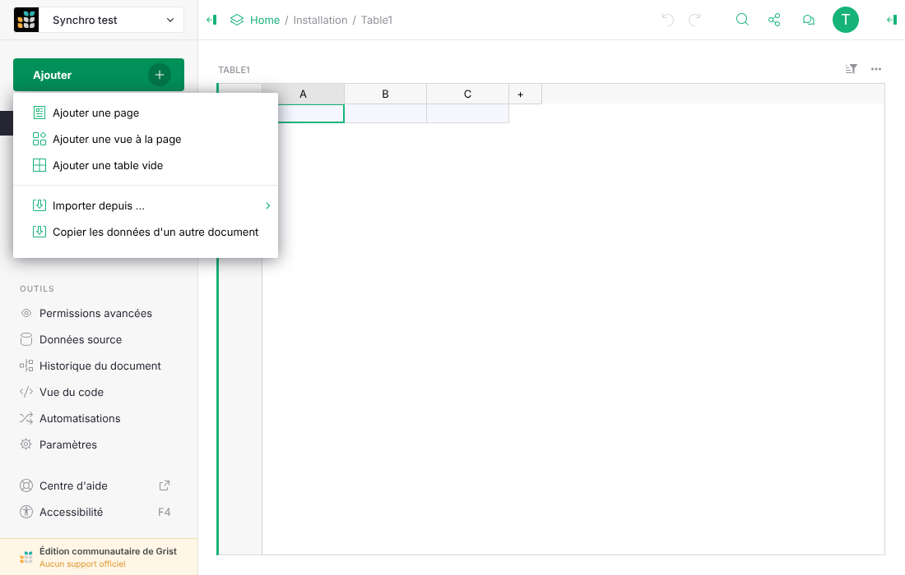
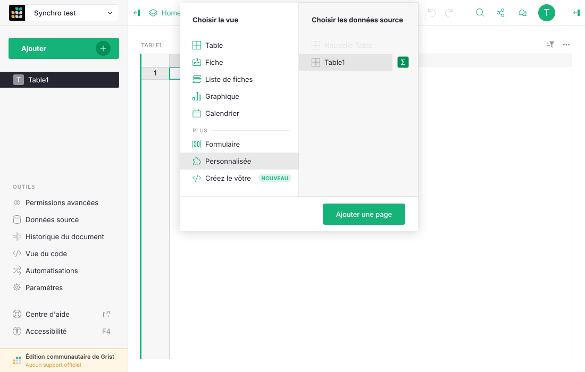
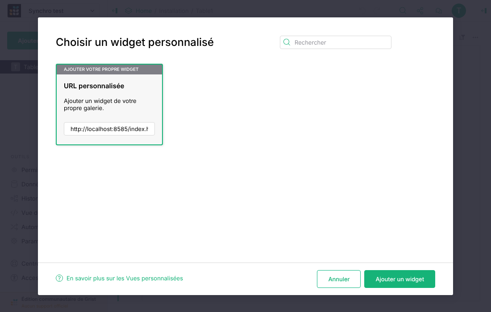

### Donner l'accès complet au document

Dans le **panneau de droite** de Grist (icône tout en haut à droite
si le panneau est fermé), cliquer sur le widget, puis, dans la section **Niveau d'accès**,
cliquer **Accepter**, ou choisir **Accès complet au document** dans la liste. Sans cet accès, le
widget reste bloqué sur un message, avec ces mêmes images.

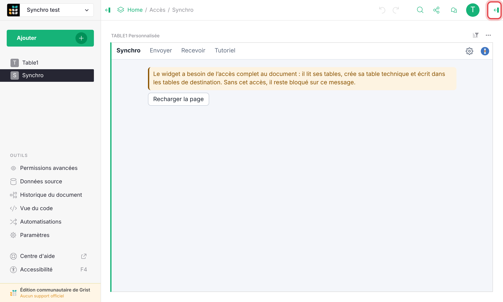
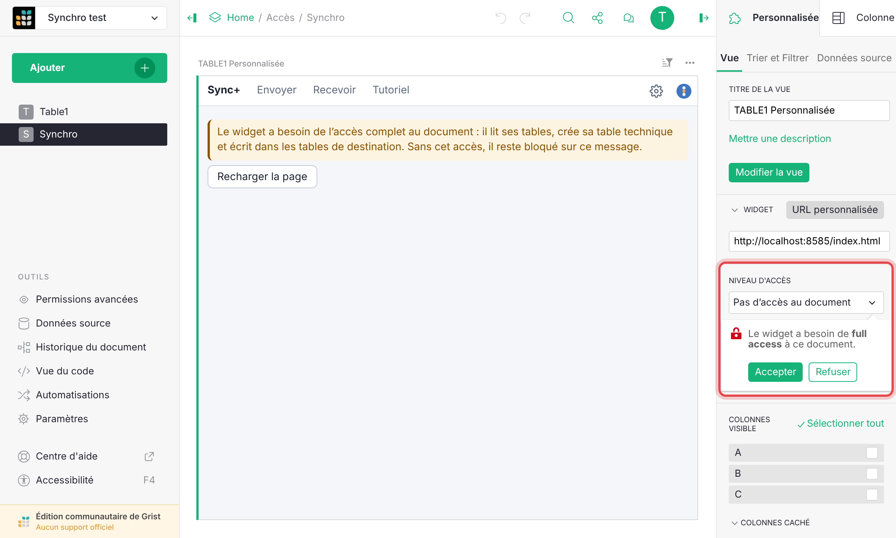
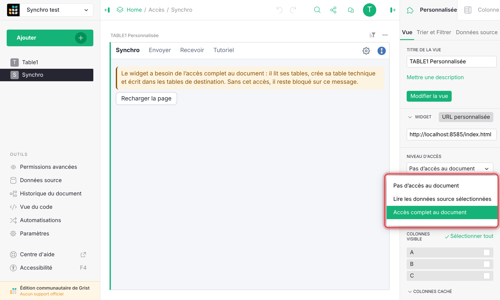

**Pourquoi l'accès complet ?** Le widget lit la structure du document (tables et colonnes, pour
proposer exports et destinations), crée sa table technique et ses colonnes de suivi, écrit dans les
tables de destination et, pour un propriétaire, gère les webhooks et les règles d'accès qu'il pose.
Un accès en lecture ne le permet pas (voir [Accès au document](../README.md#accès-au-document)). Il
ne parle qu'à l'instance Grist, jamais à un autre serveur.

Renommer la page, par exemple « Sync+ ». Ne pas créer soi-même de table nommée Synchro :
c'est le nom de la table technique que le widget crée seul. Les tables techniques n'ont pas de
page : elles sont dans « Données source ».

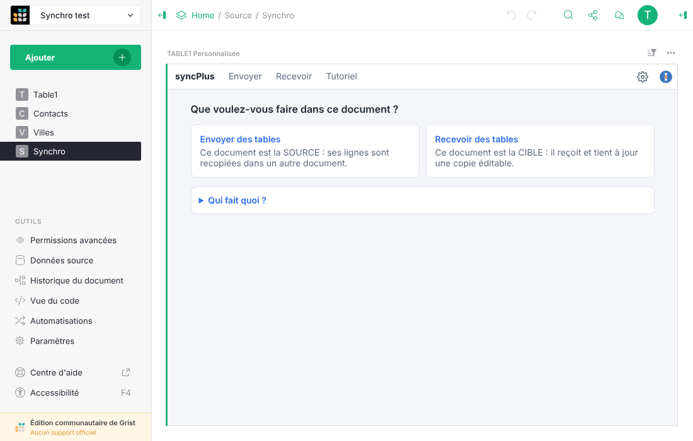

Au premier lancement, le widget demande le rôle du document. Ensuite il ouvre directement
**Recevoir** dans un document qui reçoit, **Envoyer** dans un document qui envoie.

## Côté SOURCE : créer un export

### 1. Choisir les tables

**Envoyer**, **Nouvel export**, cocher les tables de l'export.

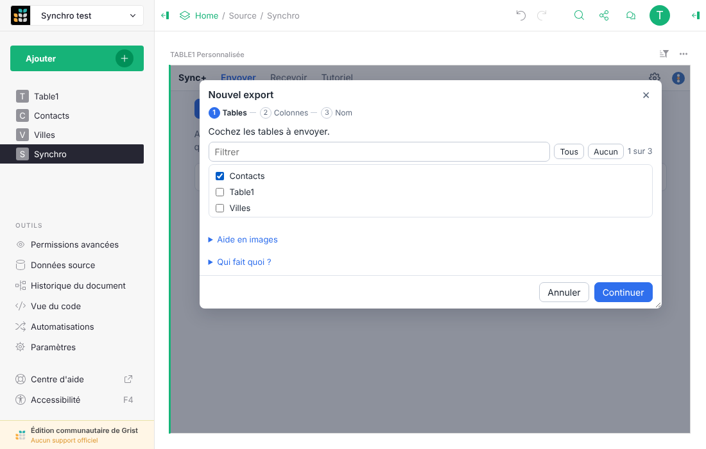

### 2. Choisir les colonnes

Cocher les colonnes qui partent (toutes par défaut, sauf les pièces jointes, à cocher : voir
[Pièces jointes](#pièces-jointes)). Le reste ne sort jamais du document. Une
Référence part comme le texte qu'elle affiche. Les colonnes
valent pour toutes les personnes qui reçoivent l'export. **Tous** et **Aucun** cochent ou décochent
d'un coup les colonnes que la recherche affiche, et la liste s'agrandit par son coin (la fenêtre
aussi).

En option, un **filtre de lignes** par table (**Filtrer les lignes**, puis **Ajouter une
condition**) : une colonne, un opérateur et ses valeurs. Selon le type de la colonne : *est l'une
de* (valeurs existantes à cocher, avec leur nombre de lignes), *contient*, *commence par*, *est
vide* ; =, >, <, *est entre* pour un nombre ; *avant le*, *après le*, *entre* pour une date ;
*cochée* ou non pour une case à cocher. Une Référence ou une Liste de références se filtre par les
fiches citées : une fiche renommée reste dans le filtre. Plusieurs conditions se combinent (toutes,
ou au moins une), et le nombre de lignes qui partiront s'affiche pendant le réglage. Une ligne qui
sort du filtre est effacée chez les destinataires.

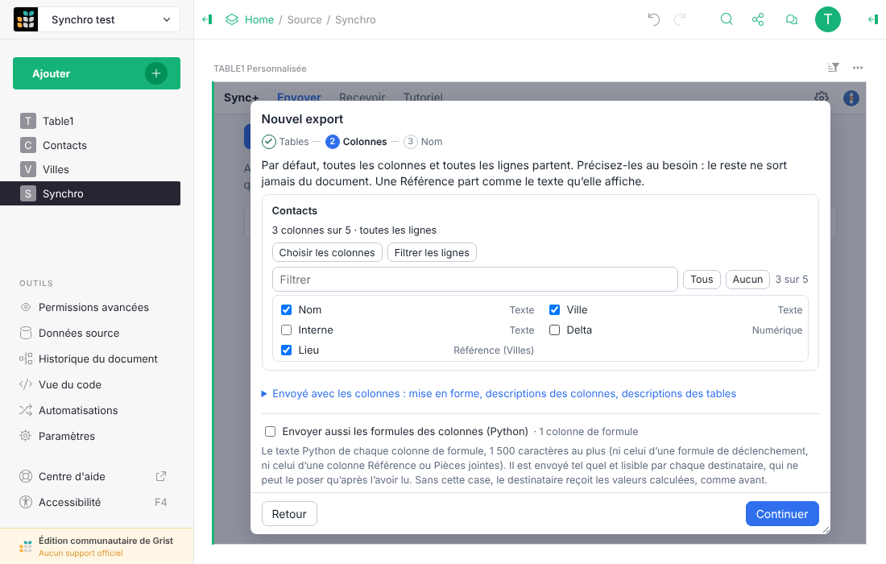

Le widget dit ce qu'il ajoutera, et ne l'ajoute qu'à la dernière étape :

- `id_sync` dans chaque table : identifiant stable de chaque ligne (les `id` de Grist sont
  réutilisés) ;
- `MajLe` dans chaque table : date du dernier changement d'une valeur envoyée (y compris le texte
  affiché par une Référence), pour remettre les versions dans l'ordre et repérer ce qui doit
  partir ;
- la table technique `Synchro`, une seule pour tout le document, quel que soit le nombre d'exports
  et de tables : pour chaque table d'un export, une ligne liste les `id_sync` existants (les vraies
  suppressions partent ainsi), une autre porte les lignes qui viennent d'être modifiées.

Une colonne `Supprime` (case à cocher) déjà présente dans une table est prise en compte : une ligne
cochée est retirée de la CIBLE sans être effacée de la SOURCE. Le widget ne l'ajoute pas.

### 3. Nommer l'export

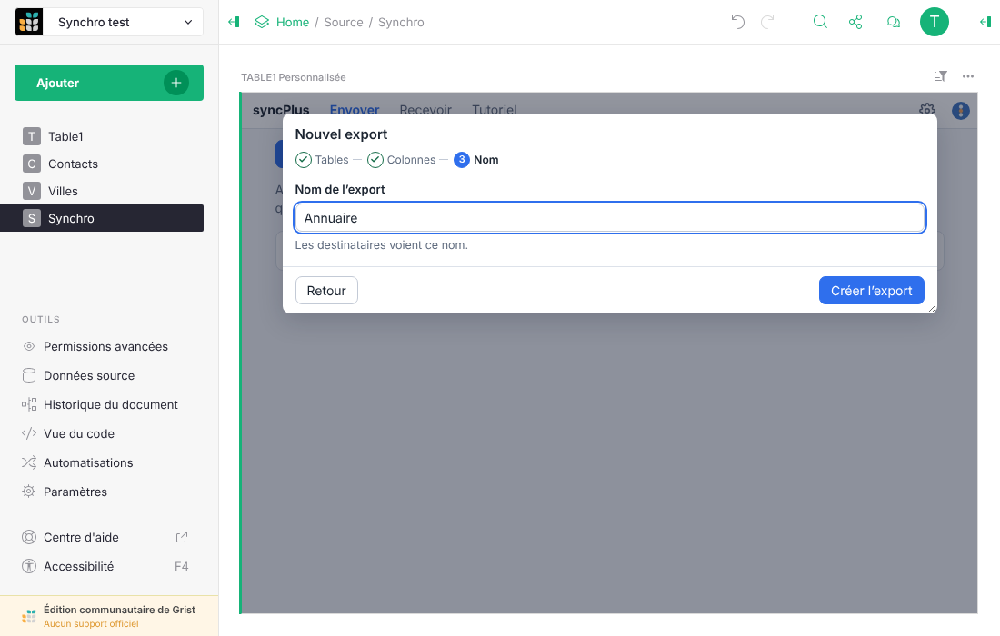

Les destinataires voient ce nom. **Créer l'export**, puis **Ajouter un destinataire**.

### 4. Ajouter un destinataire

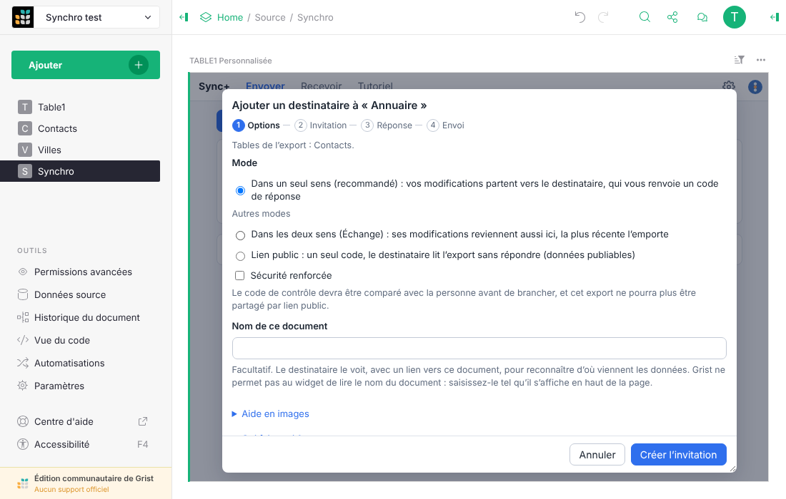

Choisir le mode. L'invitation porte toujours un secret, qui garantit que la réponse vient de
quelqu'un qui l'a reçue, et vaut 7 jours. La case **Sécurité renforcée** rend obligatoire la
comparaison du code de contrôle (étape 10) et interdit le lien public pour cet export : à cocher pour
des données sensibles. La CIBLE applique les suppressions de la SOURCE telles quelles (elle peut
garder ses lignes avec l'option Archive) ; c'est la SOURCE qui est avertie quand beaucoup de lignes disparaissent.

Le champ **Nom de ce document** (facultatif) est montré à la CIBLE, avec un lien vers ce document
qui s'ouvre dans un nouvel onglet (le lien suffit à ceux qui ont accès au document ; les autres
tombent sur le message d'erreur de Grist). Grist ne permet pas au widget de lire le nom du
document : il se saisit une fois, tel qu'il s'affiche en haut de la page, le widget le retient pour
les invitations suivantes et il se corrige à chaque fois. Sans nom, la CIBLE voit seulement un lien
« Document source ». De son côté, la SOURCE voit le nom du document du destinataire (lu chez Grist,
donc vérifié) en lien sur sa ligne.

À la première invitation, le widget réserve la table `Synchro` aux propriétaires du document (une
règle d'accès, reconnaissable à son mémo) : Grist recharge alors la page une fois.

### 5. Copier l'invitation

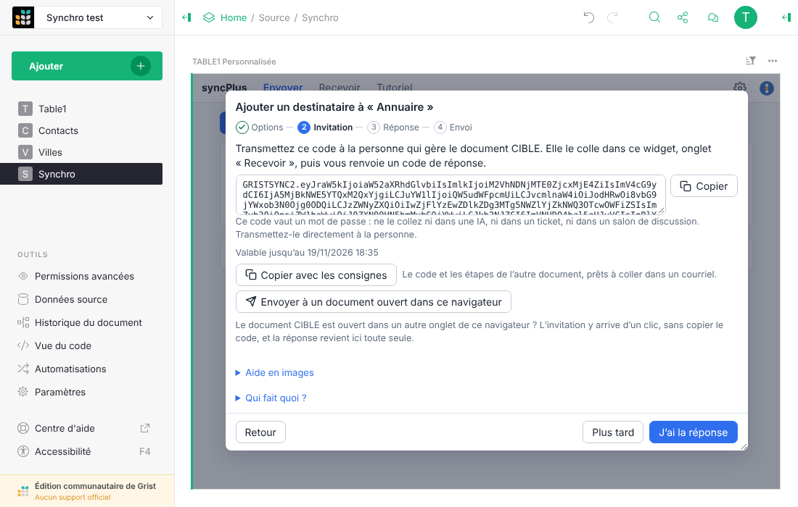

Envoyer ce code à la personne de la CIBLE, directement : il vaut un mot de passe (pas dans une IA,
un ticket ou un salon de discussion). **Plus tard** ferme l'assistant : l'invitation reste en
attente sur la carte de l'export, avec sa date d'expiration ; expirée, **Refaire le code** en
produit une nouvelle.

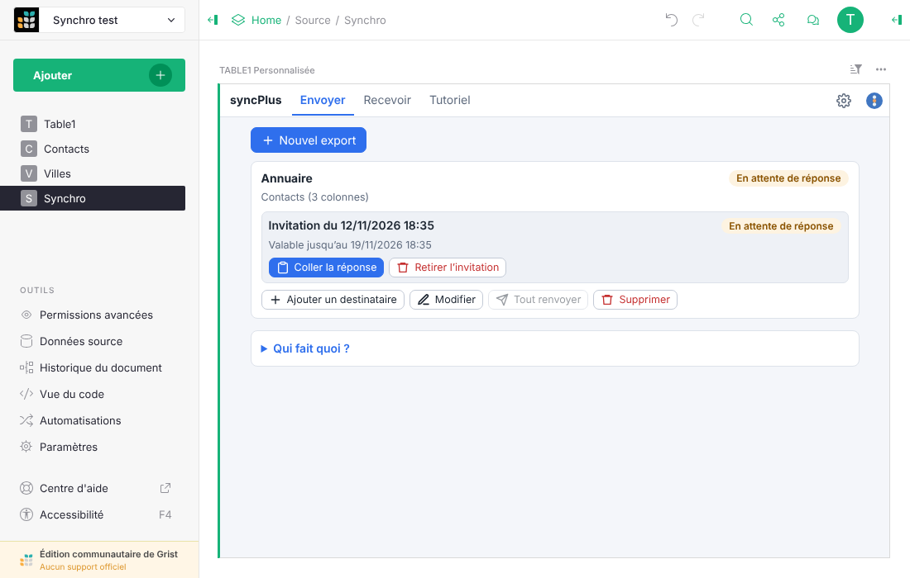

## Côté CIBLE : accepter

### 6. Coller le code

**Recevoir**, **Accepter une invitation**, coller le code.

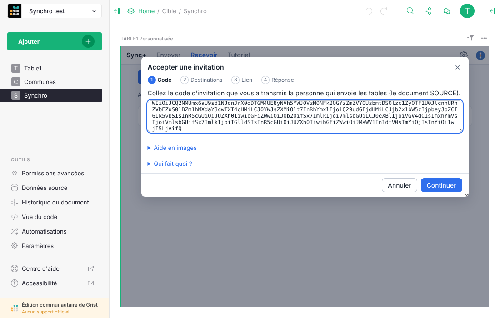

### 7. Choisir les destinations

Pour chaque table de l'export, ouvrir la liste et choisir **Nouvelle table** (nom modifiable) ou
une table du document. Pour une table existante, le widget demande où va chaque colonne et par
quelle colonne rattacher les lignes déjà là (voir [Une table ajoutée à l'export](#une-table-ajoutée-à-lexport)).

**Une table déjà remplie** : si le type d'une colonne d'ici ne convient pas à ce que la SOURCE envoie
(du texte dans une colonne numérique, une Référence, des pièces jointes), le widget le dit sous le
champ et demande de confirmer avant de continuer ; Grist garde alors les valeurs qui ne conviennent
pas, mais les marque invalides. Tant que « Appliquer automatiquement les colonnes que la SOURCE
ajoute à l'export » reste décochée (options avancées, décochée d'emblée), **rien n'est écrit dans une
table qui existait déjà** avant que la carte de la réception ait montré ce qui arriverait : lignes
ajoutées, lignes d'ici rattachées à une ligne de la SOURCE, valeurs d'ici remplacées, lignes qui ne
bougent pas, avec quelques exemples. **Appliquer** fait la première recopie ; les modifications
suivantes passent seules. Sans colonne commune choisie, l'aperçu prévient que des lignes déjà là
risquent d'être en double.

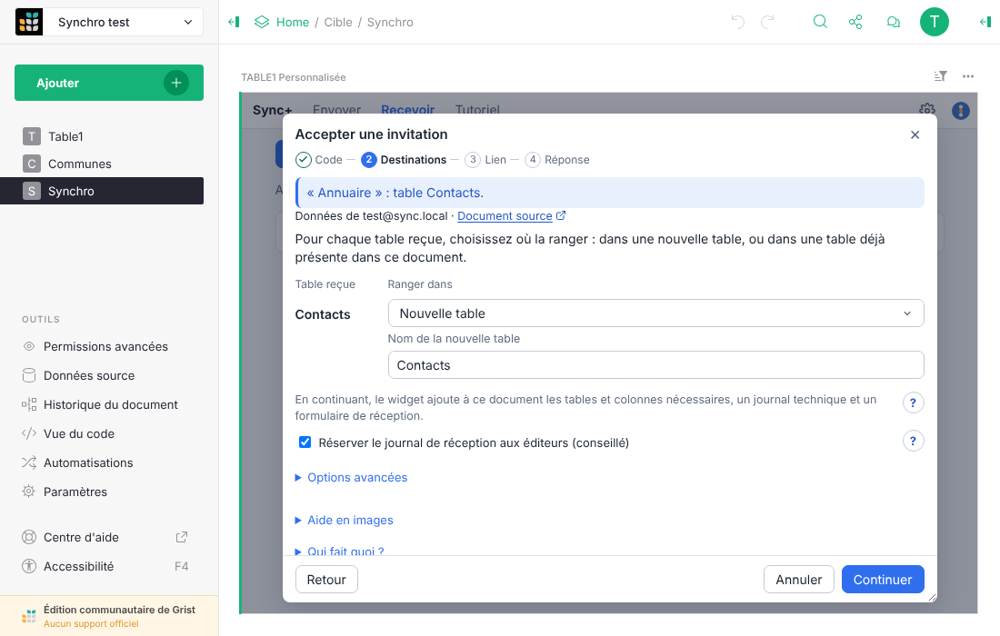

Le widget crée un journal pour l'export, `Journal_<export>` (dans « Données source »), et publie
son formulaire de réception sur sa propre page, `Journal_<export>`, rangée juste sous la page de la
table qui reçoit (une page que vous rangez ensuite à la main n'est jamais déplacée).

**Nouvelle table.** Le widget la crée avec sa propre page, **sans lui dessus** : il ne recopie les
données reçues que page du widget ouverte, donc qui reste sur la page de cette table ne reçoit rien
de nouveau. Une fenêtre le dit avant de créer quoi que ce soit. Pour sécuriser la réception, créer
d'abord la table soi-même, y ajouter le widget (Ajouter un widget à la page, Personnalisée, accès
complet), puis refaire la procédure depuis cette page en choisissant la table existante ; ou
continuer, puis cliquer **Ajouter le widget à la page de <table>** sur la carte de la réception :
le widget pose une section de lui-même sur la page de la table reçue (avec plusieurs tables, la
fenêtre demande laquelle). Grist demande ensuite l'accès complet pour cette section : ouvrir la
page, puis le panneau de droite (icône tout en haut à droite) et cliquer sur « Accepter ». Un seul
widget ouvert suffit pour toutes les réceptions du document, tables et Références comprises (leur
état est dans le document, pas dans une copie du widget) : le bouton sert à le poser là où vous
travaillez. Le bouton disparaît dès que le widget est sur la page d'une table de la réception.

**Réception supprimée.** Si le journal est supprimé (avec ou sans la table qui reçoit), l'onglet
Recevoir le dit : « Réception supprimée : <export> », ce qui reste des tables, ce que fait la SOURCE
(son prochain envoi échoue, elle met la personne en pause d'office) et comment s'en sortir
(Ctrl+Z ou « Historique du document », sinon nouvelle invitation). Le widget s'en souvient par une
note dans le partage du formulaire, que Grist garde quand la page disparaît ; « Retirer cet avis »
l'efface, avec l'ancienne clé d'écriture. Pas de note pour une réception par lien public (pas de
formulaire).
La case **Journal réservé aux éditeurs** (cochée) cache le journal aux lecteurs du document : il
garde les versions reçues et ce qu'elles ont remplacé.

### 8. Copier le lien du formulaire

L'assistant montre où cliquer : ouvrir la page du formulaire, en bas de la liste des pages, puis dans sa
carte **Partager** et **Copier le lien** ; coller ce lien dans le widget, **Tester le lien**. Le
widget vérifie que le lien écrit bien dans le journal de cette réception (le lien d'un autre
formulaire ou d'un autre document est refusé). Un seul lien sert pour toutes
les tables de l'export, et pour celles qui s'y ajouteront.

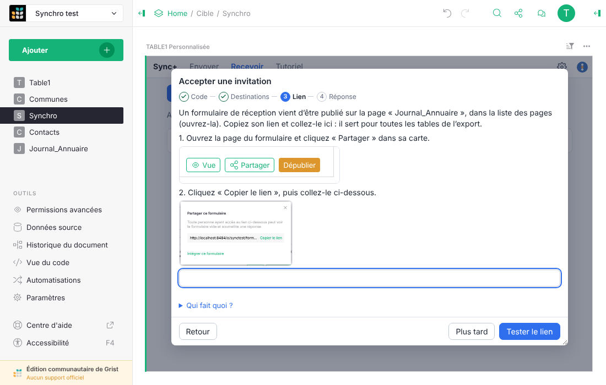

Ce lien est un **droit d'écriture** dans votre journal : ne le diffusez pas ailleurs. Chaque
réception a le sien, sur sa page.

### 9. Renvoyer la réponse

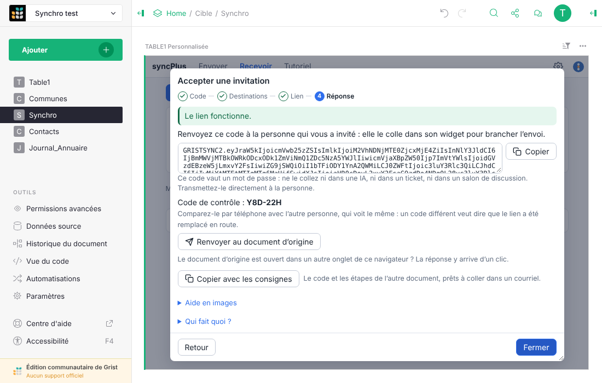

Copier le code de réponse et le renvoyer à la SOURCE. Il contient l'adresse d'écriture et votre
fiche (courriel, document, équipe). Le **code de contrôle** affiché dessous (six caractères) est
celui que la SOURCE verra : comparez-le avec elle par téléphone.

## Côté SOURCE : approuver

### 10. Coller la réponse

Sur la carte de l'export, ligne de l'invitation, **Coller la réponse**. Le widget montre qui a
accepté, le document qui recevra tel que Grist le donne (nom, dossier, équipe : une réponse qui
désigne un autre document est refusée, un espace personnel est signalé), le code de contrôle et
les tables qui partiront. Comparer le code avec la personne (obligatoire en sécurité renforcée),
puis **Approuver et brancher**. Grist reçoit un webhook filtré sur cet export : la personne ne
reçoit que ses lignes. Ensuite, le widget revérifie toutes les heures que ce webhook écrit
toujours dans ce document, et alerte sinon.

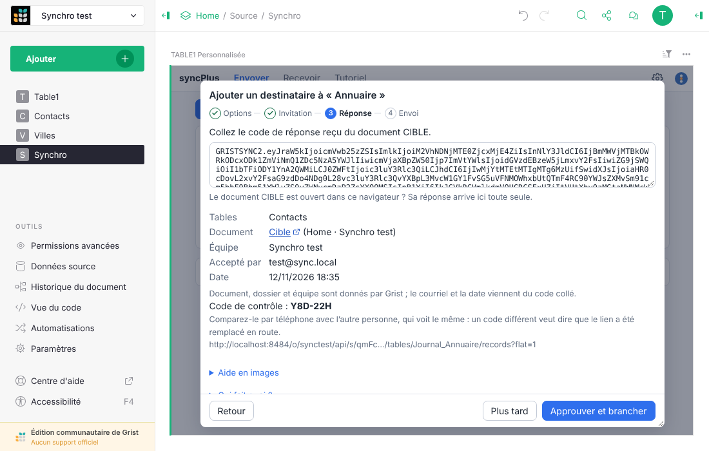

### 11. Envoyer les lignes existantes

Le branchement n'envoie que les changements à venir. **Envoyer** pousse les lignes déjà là.

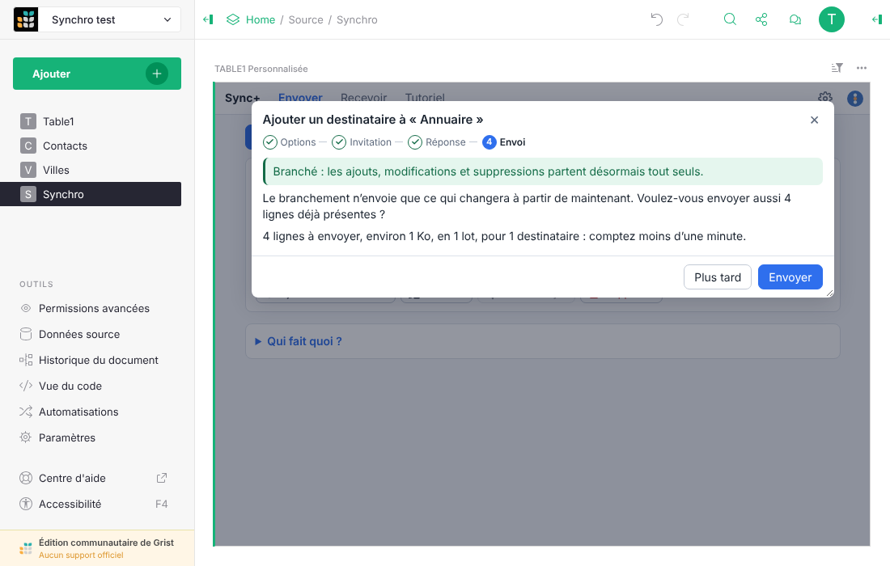

## Gérer un export

La carte de l'export liste ses tables et ses destinataires, chacun avec son dernier envoi reçu.

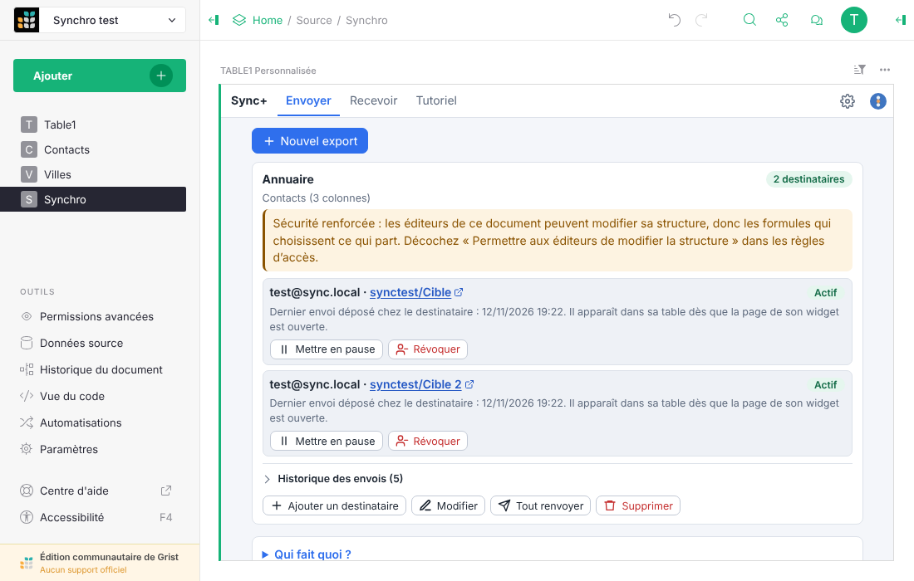

Pour l'export :

- **Ajouter un destinataire** : une invitation de plus, sans refaire l'export ;
- **Modifier** : ajouter ou retirer des tables, changer les colonnes ou le nom. Cela vaut pour tous
  les destinataires ; les lignes concernées repartent, une table ajoutée leur est proposée (voir
  plus bas) ;
- **Tout renvoyer** ;
- **Supprimer** : coupe tous ses destinataires ; la table `Synchro` disparaît avec le dernier
  export. Les colonnes `id_sync` et `MajLe` restent dans vos tables.

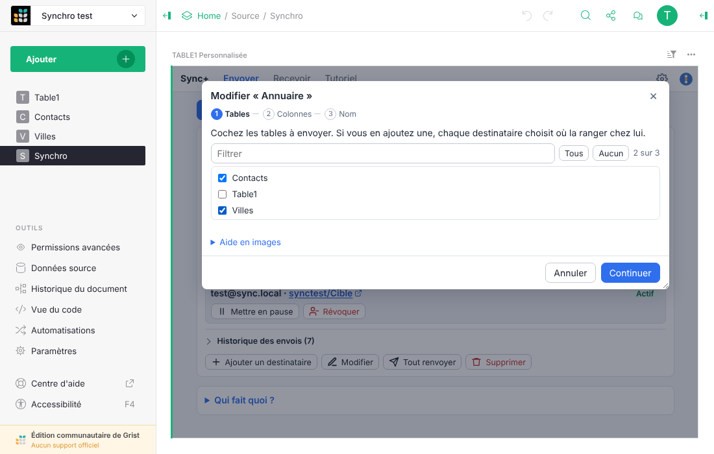

**Colonnes ajoutées après coup** : une colonne que vous ajoutez à une table de l'export ne part pas
toute seule. La carte de l'export le dit (« N colonnes ne partent pas ») avec deux boutons :
**Envoyer ces colonnes** enregistre l'export avec elles et renvoie la table, **Ne pas les envoyer**
les range (la carte n'en parle plus). Une colonne renommée ou d'un autre type est dite par son nom
(« la colonne « Ville » n'existe plus ; « Commune » est du même type, elle a sans doute été
renommée ») : **Modifier** remet l'export d'accord. À l'étape Colonnes, la case « Envoyer aussi les
colonnes que j'ajouterai à ces tables » (décochée d'emblée) les envoie seules quand un propriétaire
ouvre la page du widget.

Pour une personne :

- **Mettre en pause**, puis **Reprendre** : Grist n'envoie rien pendant une pause. À la reprise, le
  widget propose de **rattraper** (recommandé) : il renvoie seulement les lignes modifiées ou
  ajoutées pendant la pause, et la liste des clés pour les suppressions ; ou de reprendre sans
  rattraper ;
- **Débloquer la file**, quand un envoi échoue (Grist bloque alors toute la file du document
  environ 15 minutes) : le widget vide la file, puis renvoie seul ce qu'elle portait (gardez la
  page ouverte) ;
- **Révoquer** : ses envois s'arrêtent, les autres destinataires continuent.

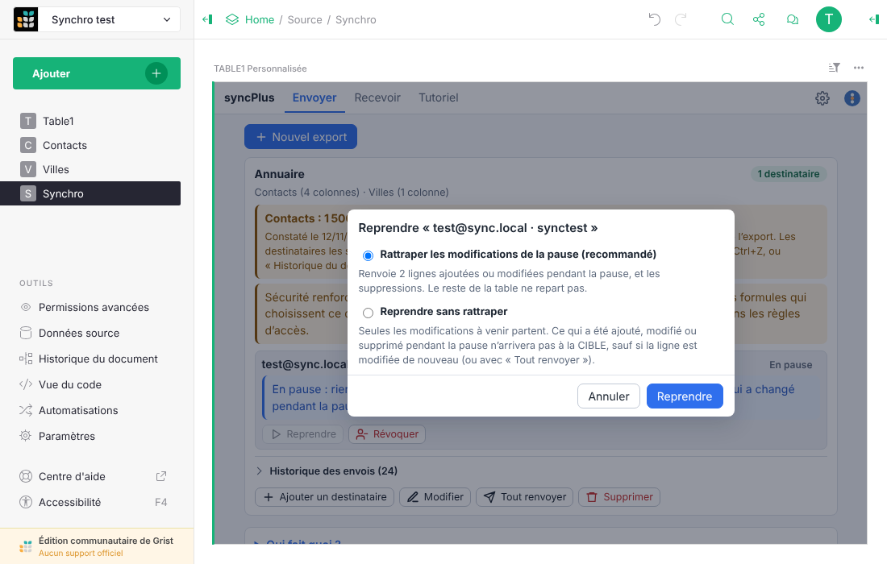

Un renvoi (après l'ajout d'un destinataire, une reprise, **Tout renvoyer**) part vers tous les
destinataires de l'export. Chez ceux qui avaient déjà ces lignes, il est sans effet : une ligne que
la SOURCE n'a pas changée garde ses retouches.

Un envoi long se prévoit et se suit. Avant **Tout renvoyer** (ou **Envoyer** à l'ajout d'un
destinataire), le widget dit ce qu'il va coûter : lignes, taille, lots, durée (et demande
confirmation au-delà de trois minutes). Pendant l'envoi, la carte de l'export affiche où il en est
(lignes et lots, temps restant), la pause qui ménage le serveur de Grist (20 Mo par tranche de
10 minutes, tous destinataires confondus) avec l'heure de reprise, et, si un destinataire est en
erreur, pourquoi rien ne part. Gardez une page du widget ouverte jusqu'à la fin ; si elle se ferme,
l'envoi reprend là où il s'est arrêté à la prochaine ouverture par un propriétaire.

## Au quotidien, côté CIBLE

Chaque ajout, modification ou suppression dans la SOURCE arrive dans le journal en une seconde
environ, même si personne n'a le widget ouvert. La **recopie** dans les tables de destination se
fait quand un éditeur ouvre la page du widget (même replié), puis tant qu'elle reste ouverte :
toutes les 10 secondes, le widget demande à Grist quelles tables ont changé, et ne relit que
celles qui ont bougé.

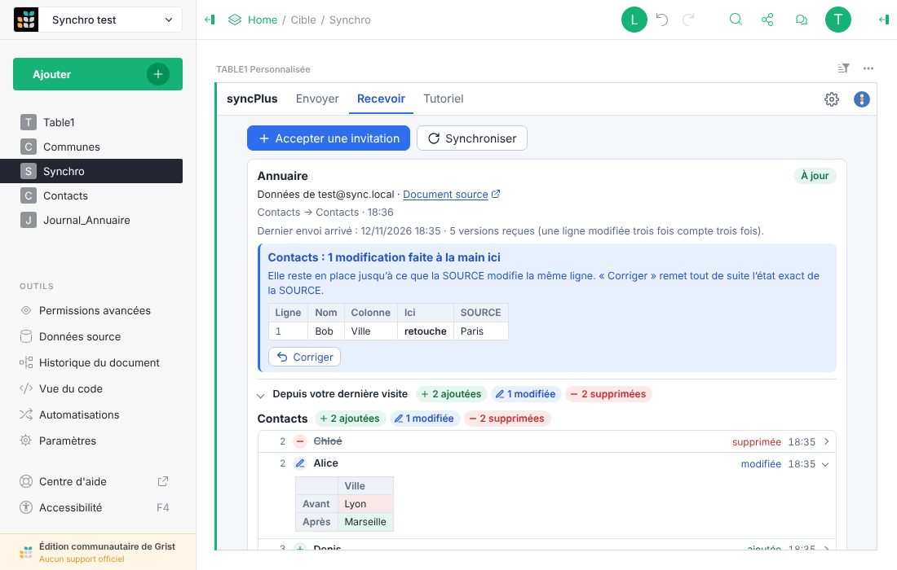

La carte montre le propriétaire des données, chaque table reçue avec sa destination et son dernier
passage, et l'historique, replié : depuis votre dernière visite, par table, le nombre de lignes
ajoutées, modifiées et supprimées, puis les lignes elles-mêmes (20 au plus par table), avec leur
numéro de ligne dans votre table et nommées par la colonne de votre choix. Chaque ligne s'ouvre au
clic sur ses valeurs avant et après, en petit tableau. Ce que vous ouvrez le reste. Une colonne
que la SOURCE ajoute à l'export y est annoncée (« Colonne … ajoutée par la SOURCE ») : toutes les
lignes reçoivent alors sa valeur.

Une retouche faite à la main dans la CIBLE reste en place jusqu'à la prochaine modification de la
même ligne dans la SOURCE, qui reprend alors toutes ses valeurs. En attendant, la carte la signale
(« modifications faites à la main ici ») avec, pour chaque cellule, le numéro de ligne, la valeur
d'ici et celle de la SOURCE. Une ligne reçue supprimée ici, ou une colonne reçue supprimée ici, est
signalée de même : la colonne n'est pas recréée en douce. L'alerte apparaît une dizaine de
secondes après la retouche, page du widget ouverte (sinon dès son ouverture). **Corriger**, sous
l'alerte, remet après confirmation l'état exact de la SOURCE : valeurs, lignes (en fin de table) et
colonnes. Une table ou une colonne de destination peut être
renommée : la recopie suit. **Arrêter la réception** efface le journal, son formulaire et sa page,
et garde les tables de destination.

### Une table ajoutée à l'export

Quand la SOURCE ajoute une table à l'export, ses lignes arrivent dans le même journal, et le widget
demande où la ranger, dans une fenêtre qui s'ouvre seule :

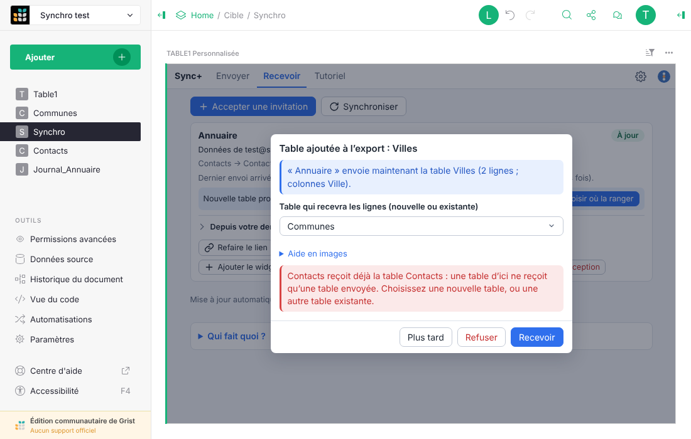

- **Recevoir** dans une nouvelle table, ou dans une table du document : le widget demande alors où
  va chaque colonne envoyée (la même, une autre, ou une nouvelle) et par quelle colonne **rattacher
  les lignes déjà là** : une ligne déjà présente dont cette colonne a la même valeur qu'une ligne
  reçue est mise à jour au lieu d'être doublée. Ici, `Ville` va dans `Commune`, et Lyon, déjà là
  avec une note, est rattachée ;
- **Refuser** : ses lignes sont effacées du journal à mesure qu'elles arrivent ;
- **Plus tard** : la table reste proposée sur la carte, ses lignes attendent dans le journal.

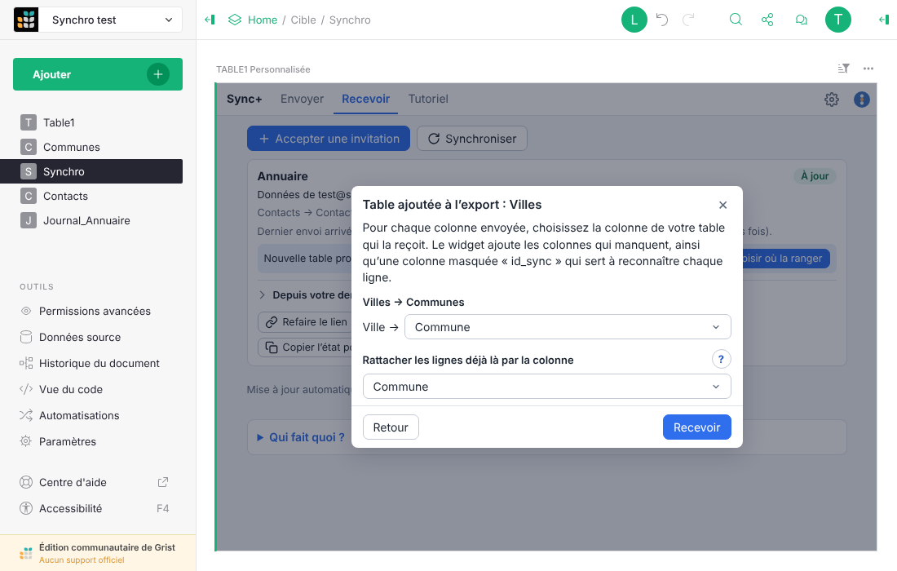

### Gros changements, valeurs venues d'une autre table

Un envoi de Grist est limité en taille : un changement de plus de 2 000 lignes environ, fait d'un
seul coup (un import, un remplacement), ne part qu'en partie. Grist note dans la table `Synchro`
depuis quand des lignes manquent, et le widget SOURCE envoie le reste par tranches, **seul**, dès
qu'un propriétaire ouvre sa page (même repliée). En attendant, la carte de la CIBLE dit combien de
lignes ne sont pas encore arrivées :

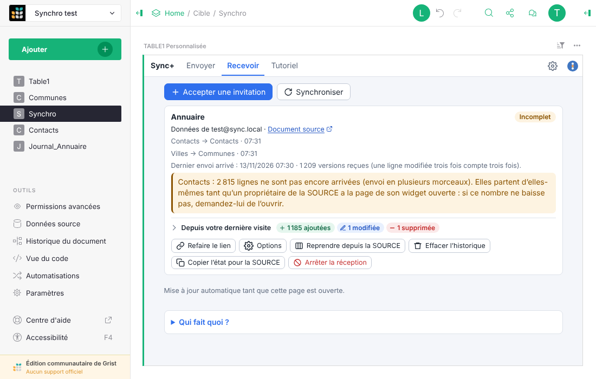

Un envoi long (premier envoi, **Tout renvoyer**, ajout d'un destinataire) part aussi par tranches, et
chaque tranche annonce combien de lignes restent à venir. Si la page du widget SOURCE se ferme en
cours de route, la CIBLE ne reste donc pas « À jour » avec une table à moitié reçue : sa carte dit
combien de lignes n'ont pas encore été envoyées, et l'avis disparaît à l'arrivée de la dernière
tranche, dès que la page de la SOURCE se rouvre.

Un envoi qui ne part jamais (Grist redémarré, file d'envoi vidée) n'a pas de tranche à annoncer. Chaque
lot dit donc aussi combien de lignes la table de la SOURCE a au total. Quand la CIBLE en a reçu moins
et que rien n'a changé depuis 10 minutes, sa carte le dit (« la SOURCE annonce 30 000 lignes, mais
seules 29 400 sont arrivées ici ») : il suffit qu'un propriétaire de la SOURCE ouvre la page de son
widget et clique sur **Tout renvoyer**. Pas d'alerte pendant un envoi en route, en Échange, ni par
lien public ; un surplus n'en est pas une. Le manque n'est vu qu'à l'arrivée d'un lot suivant : si
plus rien n'est modifié dans la SOURCE, la CIBLE ne peut pas le deviner.

Une valeur qui change à cause d'une autre table (le nom d'une ville renommée, affiché par une
Référence, ou une formule) repart seule, sans toucher la ligne.

Une **grande table** part comme une petite : la liste de ses clés tient en 256 empreintes, dont
seules celles qui changent partent, et le widget envoie la liste complète par morceaux quand il
le faut (vérifié avec 21 000 lignes). Si des envois en attente dépassent ensemble la taille
permise par Grist, 1 Mo (la CIBLE a refusé un moment), le widget SOURCE vide la file et renvoie
tout, seul, dès qu'un propriétaire ouvre sa page.

### Pièces jointes

Une colonne **Pièces jointes** part si on la coche dans l'export (elle ne l'est pas d'office : ses
fichiers peuvent peser lourd). La CIBLE la reçoit comme une vraie colonne Pièces jointes : les
fichiers s'ouvrent, se téléchargent et se prévisualisent comme ceux du document.

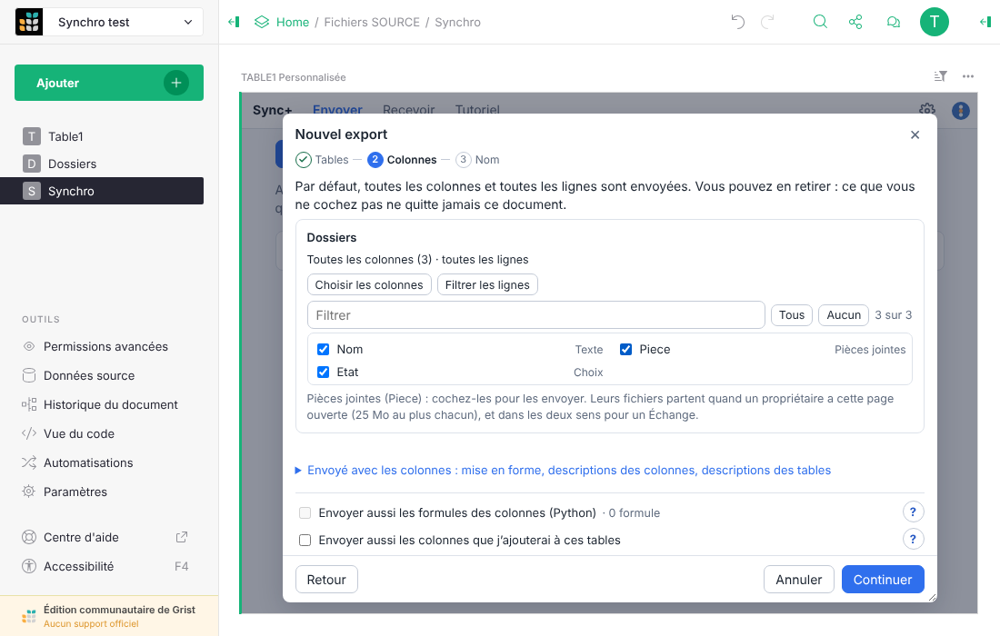

Une formule de Grist ne lit pas le contenu d'un fichier : la **liste des fichiers** de chaque
cellule (nom, taille, empreinte) part avec la ligne, tout de suite, même page fermée ; leur
**contenu** part quand un propriétaire de la SOURCE a la page du widget ouverte (même repliée),
une fois par destinataire, en morceaux de 700 Ko, par le même lien que les données. En attendant,
la carte de la CIBLE dit combien de fichiers sont attendus, et la cellule se remplit dès leur
arrivée :

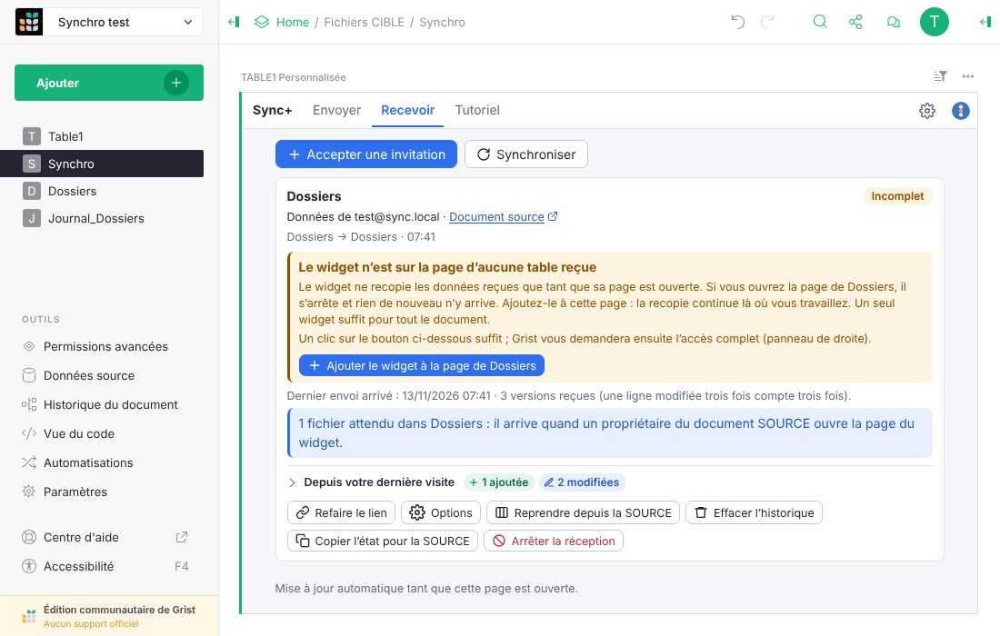

- Un fichier remplacé ou retiré dans la SOURCE l'est aussi dans la CIBLE, comme une valeur.
- **Dans un Échange, les fichiers vont dans les deux sens** : un fichier ajouté, remplacé ou retiré chez l'un
  arrive chez l'autre (seule une colonne que A a cochée revient). Un fichier reçu n'est pas renvoyé à celui qui
  l'a envoyé. Une ligne qui porte un fichier pas encore arrivé **n'est pas recopiée** tant qu'il manque (la carte
  dit « N lignes attendent leurs fichiers ») : sinon la cellule incomplète repartirait vers les autres
  participants. Les fichiers avancent quand un propriétaire du document qui envoie a la page de son widget
  ouverte ; à plusieurs, le fichier d'un participant passe par A avant d'arriver chez les autres.
- Un fichier que la CIBLE a déjà (même contenu) n'est ni renvoyé ni déposé deux fois.
- Un nouveau destinataire reçoit tous les fichiers ; **Tout renvoyer** les renvoie à chacun.
- Un fichier de plus de **25 Mo** ne part pas : la CIBLE le nomme sur sa carte. Les envois de
  fichiers suivent le même budget que les renvois (20 Mo par dix minutes et par document), pour ne
  pas charger l'instance ; les modifications ordinaires, elles, partent toujours.
- Les fichiers ne passent pas par le **lien public**, et ne vont, dans un **Échange**, que du
  document qui invite vers les autres.

### Options d'une réception, liens entre tables, historique des envois

**Options d'une réception** (hors Échange), à l'acceptation ou par le bouton **Options** de la
carte :

- **Archive** : une ligne effacée dans la SOURCE reste ici, cochée « Supprimée à la source », et
  n'est plus suivie ni signalée comme retouche. Une nouvelle version de la ligne la décoche.

  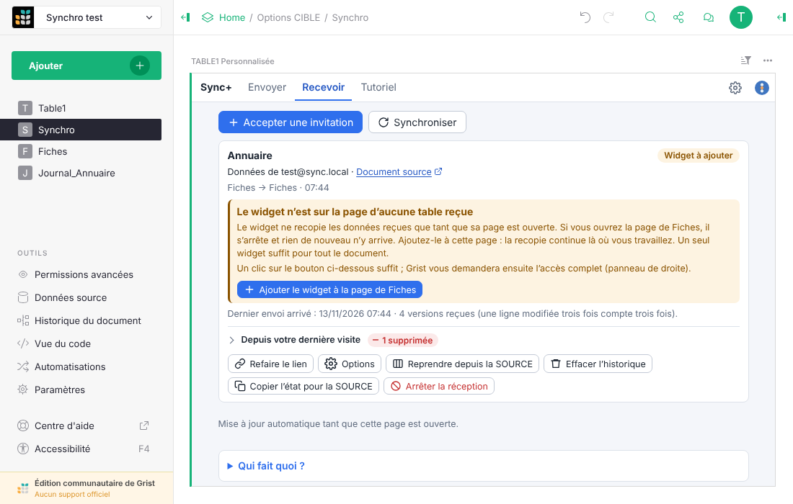

- **Colonnes ajoutées par la SOURCE** : case « Appliquer automatiquement les colonnes que la SOURCE
  ajoute à l'export », **décochée d'emblée** pour une réception nouvelle (dans « Options avancées »).
  Décochée, une colonne ajoutée à l'export n'est ni créée ni recopiée : la carte la propose avec son
  détail (table, nom d'ici, type) et attend un clic, pendant que les lignes continuent d'arriver.
  **Appliquer** crée les colonnes et les remplit d'un coup avec les valeurs déjà reçues ;
  **Appliquer, puis traiter automatiquement** ne demande plus ensuite (le réglage se change dans
  **Options**). La carte dit aussi, sans rien changer, une colonne que la SOURCE n'envoie plus (elle
  reste ici, ses valeurs ne bougent plus) ou dont le type a changé (la colonne d'ici garde le sien) ;
  **Compris** ne la répète plus. Une réception faite avant cette version crée les colonnes toute
  seule, comme avant.
- **Tables en lecture seule** : seuls les propriétaires du document écrivent dans les tables
  reçues (une règle d'accès, posée par un propriétaire). La recopie, qui écrit avec les droits de la
  personne qui a la page ouverte, attend alors qu'un propriétaire l'ouvre ; la carte le dit.

**Liens entre tables.** À l'étape Colonnes, le bloc **Références entre tables** liste chaque colonne
Référence ou Liste de références de l'export, avec la table qu'elle vise et la colonne qu'elle affiche.
Pour chacune, deux choix : **Valeurs seulement** (le destinataire reçoit le texte affiché) ou **Garder le
lien** (il reçoit une vraie Référence, ou Liste de références, vers la table reçue, qui affiche la même
colonne). Quand la table visée est déjà cochée, le lien est gardé d'emblée ; sinon ce sont les valeurs
seules qui partent, et garder le lien **ajoute la table visée à l'export** (un bloc « Ajoutée pour
un lien » le dit ; la ligne « Part en plus des tables cochées » fait le compte). Trois choix dans ce
bloc, sous « Que prendre de la table ? » : **Seulement la colonne affichée** (d'emblée), **Toute la
table** (ses Pièces jointes restent à cocher) ou **Choisir les colonnes** (la colonne affichée est
toujours envoyée, on coche les autres). On peut aussi y filtrer les lignes.

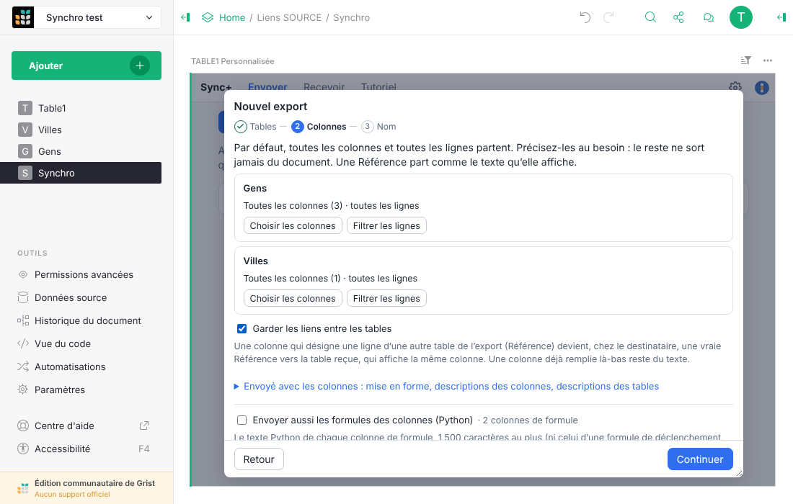

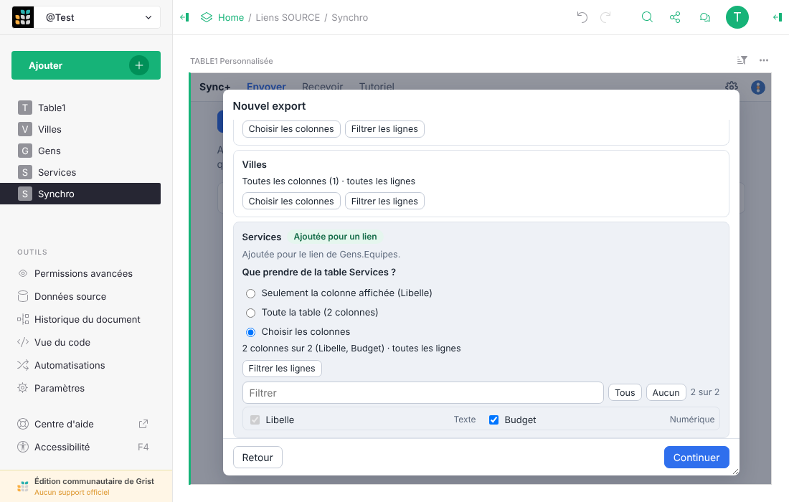

Une colonne que le destinataire avait déjà remplie de texte reste du texte (rien n'est touché sans
accord) : sa carte le dit (« … reste du texte ») et un propriétaire clique **Refaire les références**
pour la convertir et reprendre le lien envoyé par la SOURCE. **Valeurs seulement**, dans **Modifier**, rend
le texte. Une ligne qui arrive avant les lignes qu'elle vise est complétée à leur arrivée.

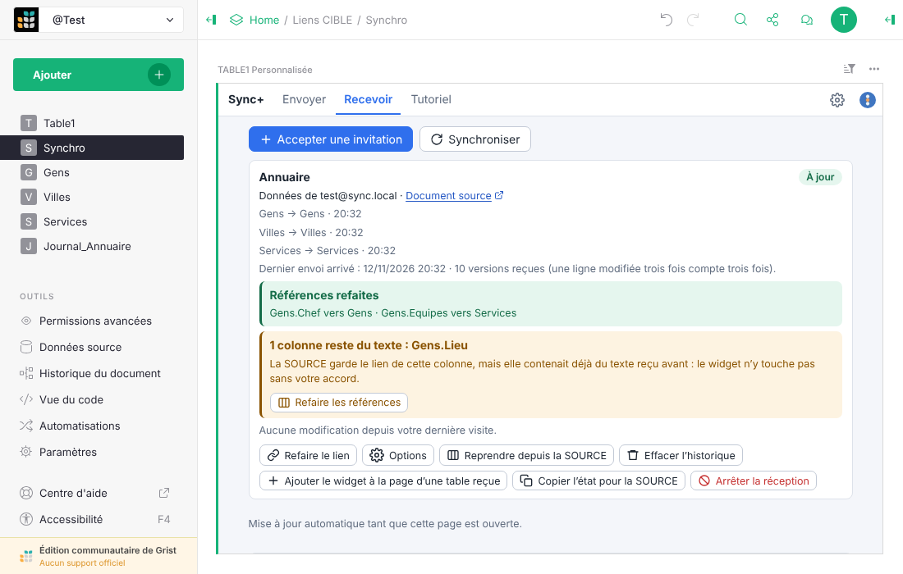

**Mise en forme des colonnes.** La case **Envoyer la mise en forme des colonnes** (étape Colonnes,
cochée d'emblée) envoie en plus des formats déjà repris : les couleurs, le style des en-têtes, la devise
et les règles de mise en forme conditionnelle simples (comparaisons sur les colonnes envoyées). Une
règle n'est jamais copiée telle quelle : elle est relue, puis réécrite avec les colonnes du
destinataire ; une règle plus complexe n'est pas envoyée. Seules les colonnes créées par le widget
la prennent, une fois : ce qui est retouché chez le destinataire reste, et le bouton **Reprendre
depuis la SOURCE** de la carte remet tout d'accord avec la SOURCE.

**Descriptions.** Deux autres cases, sous la même ligne repliée **Envoyé avec les colonnes**, envoient
le texte de la description de chaque colonne (300 caractères au plus) et celui de chaque table (500
caractères au plus). Chaque case dit combien de colonnes ou de tables sont concernées. Le texte part
tel quel et chaque destinataire peut le lire : ne cochez pas la case si vos descriptions portent des
notes internes. Chez le destinataire, une colonne créée par le widget la reçoit une fois (si elle n'en
a pas), la table aussi si la sienne est vide ; ce qui est écrit ou effacé ici n'est pas écrasé, et
**Reprendre depuis la SOURCE** (une case par élément) le remet d'accord.

**Ordre et colonnes cachées.** Une case à part, **Envoyer l'ordre et les colonnes cachées de la page**, décochée
d'emblée (elle change l'affichage chez le destinataire), envoie le rang de chaque colonne dans la page de la table
(la première vue en tableau d'une page, pas les données brutes) et celles que cette page cache. Seul l'affichage change :
les données d'une colonne cachée arrivent comme les autres. Chez le destinataire, les colonnes que le widget a créées la
reçoivent une fois (celles qui existaient déjà ne bougent pas) ; une retouche faite ici reste, et **Reprendre depuis la
SOURCE** range de nouveau la page comme celle de la SOURCE. Les tris, filtres, graphiques et autres vues ne sont pas envoyés.

**Formules.** Une case à part, **Envoyer aussi les formules des colonnes (Python)**, décochée d'emblée,
envoie le texte de chaque colonne de formule, et celui de la **formule par défaut** d'une colonne de
données (une formule de déclenchement qui ne joue que sur les nouvelles lignes ; pas celle qui se
recalcule quand une colonne change, ni celle d'une colonne Référence ou Pièces jointes). Quand vous la cochez, un message rappelle qu'une formule est du code Python
que Grist exécute et que le destinataire exécutera chez lui. Rien n'est posé tout seul : un
**propriétaire** du document destinataire ouvre **Reprendre depuis la SOURCE**, coche **Formules**, lit
chaque formule avec ce qui s'oppose éventuellement à la poser (un module système, une colonne ou une table
qui n'est pas dans ce document, une colonne qui a changé de nom), coche **J'ai lu ces formules**, puis
confirme. Seules les colonnes créées par le widget deviennent des colonnes de formule ; elles ne reçoivent
alors plus de valeurs de la SOURCE (Grist les calcule). Une formule par défaut laisse la colonne de
données : elle ne sert qu'aux lignes ajoutées ici à la main et ne change aucune valeur reçue. L'Historique
du document permet de revenir en arrière. Sur une instance dont les formules tournent sans bac à sable, demandez d'abord à son administrateur
(voir `SECURITY.md`).

**Langue du document.** Grist écrit les séparateurs des nombres et la devise par défaut d'après la
langue du document, pas d'après la colonne : un budget copié d'un document français dans un document
américain reste en dollars et en écriture américaine même si on choisit l'euro dans la colonne. Quand
la langue de la SOURCE diffère, la carte de réception le dit ; un **propriétaire** du document peut le
régler comme la SOURCE d'un clic confirmé (Ctrl+Z le défait). Le widget ne change jamais ce réglage de
lui-même.

**Listes de choix et formats** (Choix, dates, nombres) : la colonne reçue les reprend ; un choix
ajouté dans la SOURCE s'ajoute ici, et une mise en forme retouchée ici reste.

**Historique des envois**, sur la carte de l'export (replié) : destinataires ajoutés, envois et
renvois, rattrapages, pauses, révocations, modifications. Les envois ordinaires partent de Grist
sans le widget : l'état de chaque destinataire dit s'ils réussissent.

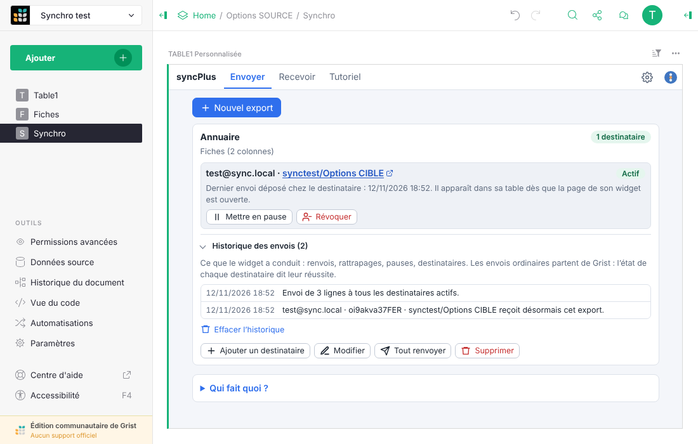

**Diagnostic** (Réglages, **Copier le diagnostic**) : version, état des exports et des réceptions,
erreurs récentes. Il ne contient aucune donnée de vos tables, ni courriel, code ou lien : on peut le
joindre à un message d'aide.

### Arrivées suspectes, couper le lien

Si des lignes arrivent dans le journal sans pouvoir venir de la SOURCE (autre export, contenu
illisible, signature absente ou fausse, date dans le futur), ou en nombre anormal, la carte affiche
**Arrivées suspectes** : rien n'a été recopié.
Si vous ne l'expliquez pas, **Couper le lien** : l'ancien lien n'écrit plus rien. La SOURCE
révoque alors l'ancien destinataire et vous envoie une nouvelle invitation ; acceptez-la ici, la
même réception reprend avec ses tables (le widget montre d'abord d'où vient l'invitation).

Une réception créée avant la version 0.5 peut avoir son formulaire sur la même page qu'un autre :
la carte le signale (**Lien commun à d'autres formulaires**), et **Couper le lien** l'en sépare.

### Suppressions

La CIBLE est passive : une ligne supprimée dans la SOURCE (ou sortie du filtre de l'export) est
supprimée ici aussi, quel qu'en soit le nombre. La SOURCE répond de ses données ; la décision ne
vous est pas demandée. Pour garder chez vous ce qu'elle retire, cochez **Archive** (dans
« Options avancées » à l'acceptation, ou dans **Options** de la carte) : la ligne reste, cochée.

Côté SOURCE, quand plus de 10 lignes et plus d'une sur cinq d'une table ont disparu de l'export
d'un coup, la carte de l'export le dit (avis pendant 24 heures, et ligne dans l'historique des
envois), avec le rappel qu'une suppression faite par erreur s'annule dans Grist (**Ctrl+Z**, ou
« Historique du document ») : les lignes repartent chez les destinataires.

## Échange, dans les deux sens

Deux documents se tiennent à jour l'un l'autre : une modification faite d'un côté passe de
l'autre, sans revenir ; quand la même ligne change des deux côtés, **la plus récente l'emporte**.
Il faut un **propriétaire** de chaque côté (chacun envoie par son propre webhook).

1. SOURCE : créer l'export, puis **Ajouter un destinataire** (le premier de l'export), mode
   **Échange**. Le widget publie un formulaire de retour sur sa propre page, en bas de la liste des pages :
   copier son lien et le coller, il part dans l'invitation (qui devient un droit d'écriture).

   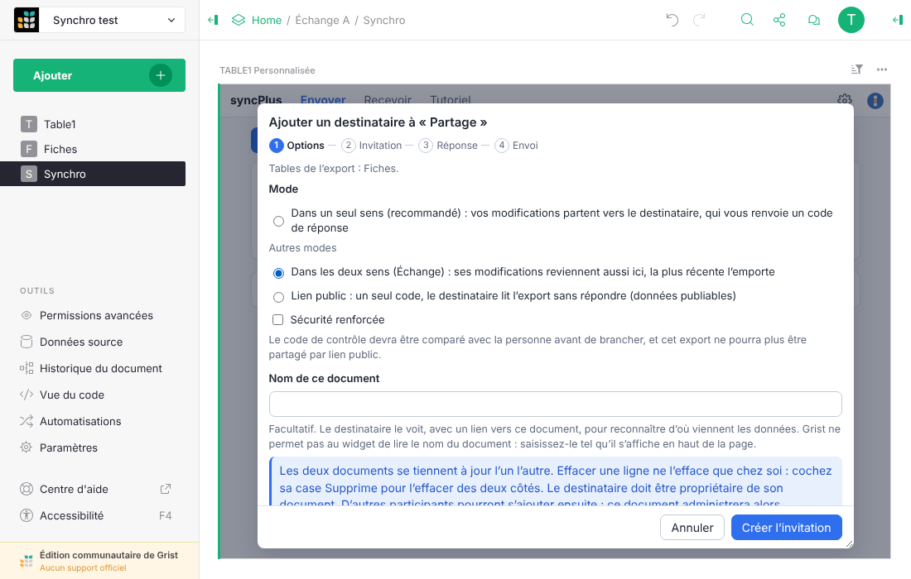

2. CIBLE : accepter l'invitation comme d'habitude. Le widget montre le document qui invite tel que
   Grist le donne, et le code de contrôle de l'adresse de retour (à comparer ; obligatoire en
   sécurité renforcée). Si une table reçue va dans une table existante, il liste les colonnes de
   celle-ci qui partiront vers la SOURCE et demande de confirmer. La réponse branche les deux sens
   à la fois.
3. SOURCE : coller la réponse, **Approuver et brancher**, **Envoyer** les lignes existantes.

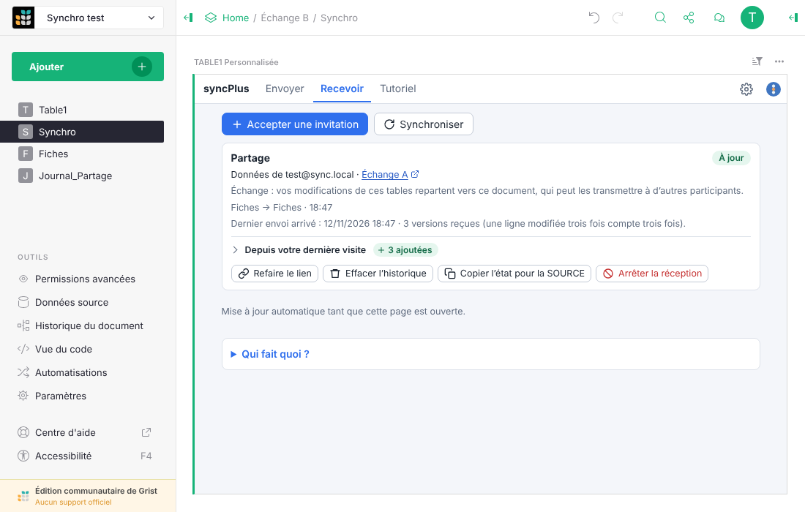

Une case `Supprime` est ajoutée aux tables : cochée d'un côté, la ligne disparaît des deux. Une
ligne déjà présente dans la CIBLE, sans clé, reste à ce document. Arrêter, d'un côté ou de l'autre,
arrête les deux sens ; les tables gardent leurs lignes.

### Échange à plusieurs

Sur un export déjà en Échange, **Ajouter un participant** invite un document de plus, avec les
mêmes étapes. Le document qui invite **administre** l'Échange : il reçoit les modifications de
chaque participant et les renvoie aux autres, la plus récente l'emportant. Les participants ne se
connaissent pas : chacun n'est branché qu'à lui. La recopie chez lui se fait quand sa page du
widget est ouverte : tant qu'elle ne l'est pas, une modification d'un participant attend dans son
journal et n'atteint pas les autres.

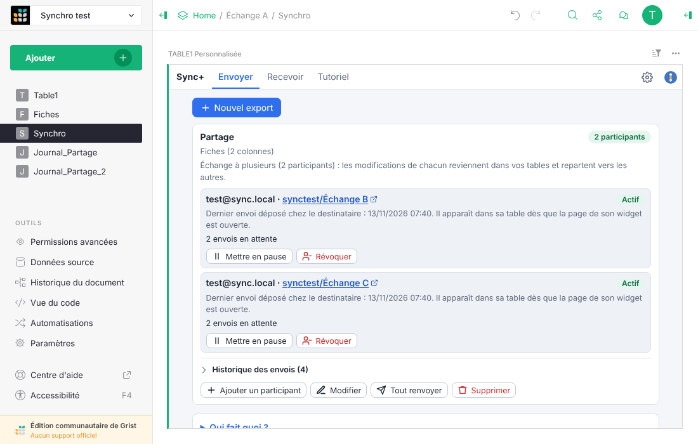

Une ligne cochée `Supprime` par un participant reste chez celui qui administre, cochée, et
disparaît chez les autres. **Révoquer** ne retire qu'un participant : son journal de retour et sa
clé sont effacés, et son propre widget arrête son envoi de retour.

### Valider ou refuser les changements des participants

Par défaut, tout changement d'un participant est accepté. Dans **Modifier**, à l'étape Nom, le
document qui administre choisit pour chaque type de changement (ligne ajoutée, modifiée,
supprimée) : **Accepter**, **Refuser** ou **À valider**.

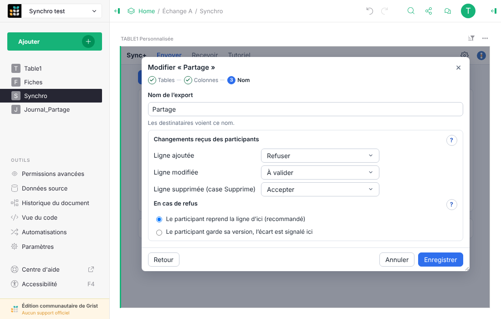

Un changement **à valider** attend sur la carte du participant, dans l'onglet **Recevoir**, avec
la valeur d'ici et la valeur proposée. Rien n'est écrit, ni transmis aux autres participants,
avant **Accepter**. **Tout accepter** et **Tout refuser** valent pour toute la liste.

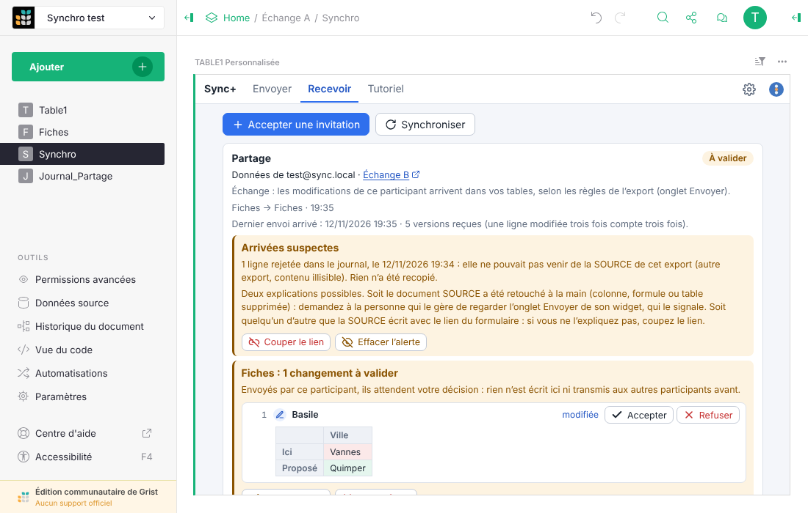

En cas de refus, le participant reprend la ligne d'ici (réglage recommandé) : une modification
refusée revient chez lui à la valeur d'ici, un ajout refusé est effacé chez lui (la ligne reste ici,
cochée `Supprime`) et une ligne dont la suppression est refusée revient. Avec l'autre réglage, il
garde sa version, et la carte signale l'écart jusqu'à la prochaine modification de la ligne.
L'historique montre les changements refusés.

## Mode lien public

À l'étape 4, choisir **Lien public** (impossible pour un export en sécurité renforcée). Le
widget liste en rouge les colonnes qui deviendront publiques, et refuse une table dont une règle
d'accès cache des lignes ou des colonnes. Il pose ensuite des règles d'accès : toute personne qui
n'est que **lectrice** du document, dont le lien public, ne voit plus que les instantanés des
exports publics, dans la table `Synchro`. Enfin, dans le menu **Partager** du document,
**Gérer les utilisateurs** : « Accès public » sur **Activé**, en **Lecture seule** (jamais
**Éditeur** : la carte le signale), puis **Confirmer**. La ligne passe de « Lien public à
activer » à « Public ».

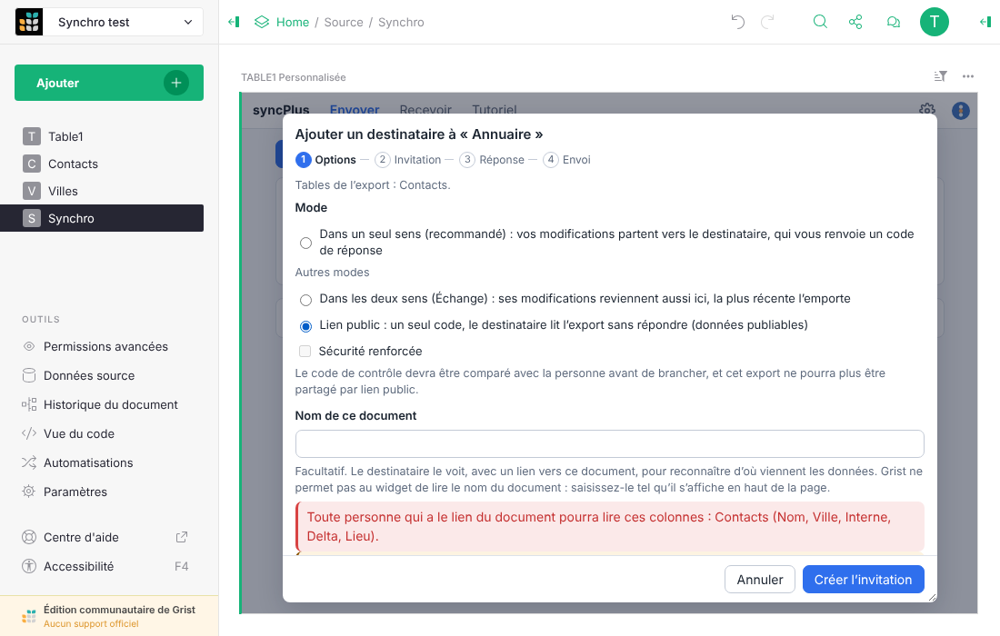

Côté CIBLE : coller le code, choisir les destinations, c'est tout. Le widget lit la SOURCE toutes
les 10 secondes tant que sa page est ouverte. À éviter pour des données qui ne doivent pas être
publiques ; les lecteurs déjà invités sur la SOURCE ne voient plus, eux aussi, que les exports
publics.

**Couper le lien public** retire l'accès à l'export. Tant que le lien public reste actif, le widget
garde la règle qui cache le reste du document : désactivez-le dans **Partager**.

## Envoyer et recevoir dans le même document, relais

Un même document peut envoyer certaines tables et en recevoir d'autres : le widget a les deux
onglets, et les deux rôles ne se gênent pas.

Une table reçue peut aussi être **relayée** vers un troisième document (A → B → C) : dans B,
**Envoyer** la propose comme une autre table. Ses lignes gardent la clé de leur document
d'origine. Deux limites :

- le second saut part quand le widget recopie les lignes dans B, donc quand un éditeur ouvre la
  page du widget de B ;
- une ligne ajoutée à la main dans la table relayée reste dans B : elle n'a pas de clé et ne part
  pas (avec une clé, la prochaine liste de A, qui ne la connaît pas, l'effacerait).

Le widget refuse les **boucles** : renvoyer une table reçue vers le document d'où elle vient, ou
une table vers elle-même. Pour une synchro dans les deux sens, utiliser l'[Échange](#échange-dans-les-deux-sens).

## Renforcer la sécurité d'un partage plus ancien

Un partage branché avec une version d'avant les clés de signature (Alpha) **continue de fonctionner, rien n'est obligatoire**. Pour qu'il soit
protégé comme les nouveaux, chaque partage se renforce une fois, personne par personne :

1. **SOURCE** : onglet Envoyer, sur la ligne du destinataire, « Renforcer la sécurité ». Le widget prépare un nouveau code (valable 7 jours) à lui
   transmettre. Seules les invitations pas encore acceptées sont à refaire de toute façon.
2. **CIBLE** : onglet Recevoir, « Accepter une invitation », coller ce code. La même réception reprend, avec ses tables et ses données ; copier le lien
   du formulaire, puis renvoyer la réponse à la SOURCE. Pendant l'attente, l'ancien envoi continue d'arriver (7 jours au plus). On peut
   « Revenir à l'ancien fonctionnement » à tout moment, tant que ce n'est pas fini.
3. **SOURCE** : « Coller la réponse », comparer le code de contrôle, « Approuver et brancher ». Le nouvel envoi remplace l'ancien et un envoi de
   contrôle part ; à sa première livraison signée, la carte de la CIBLE dit « Partage renforcé ».

Si le délai de 7 jours se termine avant la fin, la carte de la CIBLE dit « Renforcement interrompu » : renvoyer la réponse à la SOURCE, ou revenir à
l'ancien fonctionnement. Les destinataires en pause se reprennent d'abord ; un Échange d'avant les clés se reprend par une nouvelle invitation.

## Si quelque chose coince

| Symptôme | Cause probable | Que faire |
|---|---|---|
| Rien n'arrive dans la table de destination | Personne n'a ouvert la page du widget dans la CIBLE | Ouvrir la page ; les versions attendaient dans le journal |
| La ligne d'un destinataire est rouge | La CIBLE a arrêté la réception, coupé ou dépublié son formulaire | Révoquer cette personne, puis l'inviter de nouveau ; dans la CIBLE, la même réception reprend |
| Tous les envois du document SOURCE sont en retard | Un envoi en échec bloque la file | **Débloquer la file** (un envoi trop gros est débloqué seul, page du widget SOURCE ouverte) |
| Les lignes déjà présentes ne sont pas arrivées | Le branchement n'envoie que les changements | **Tout renvoyer** |
| La CIBLE dit « la SOURCE annonce N lignes, mais seules M sont arrivées » | Un envoi s'est perdu (Grist redémarré, file vidée), ou des lignes de la SOURCE ont la même clé | **Tout renvoyer** depuis la SOURCE ; si l'écart reste, chercher les clés en double (carte de l'export) |
| La CIBLE signale des lignes non arrivées | Changement trop gros pour un seul envoi, ou envoi par tranches interrompu (page du widget SOURCE fermée) | Ouvrir la page du widget dans la SOURCE (il envoie le reste seul), sinon **Tout renvoyer** |
| Des lignes manquent dans la CIBLE alors que la SOURCE dit avoir envoyé | Rien n'est arrivé, ou ce qui est arrivé attend d'être recopié (page fermée, cachée, ou un autre onglet du même navigateur qui avance seul) | Sur la carte de la réception : **Dernier envoi arrivé** et **envois arrivés pas encore recopiés** ; **Copier l'état pour la SOURCE** donne à la personne qui envoie de quoi comprendre (ni code, ni lien, ni valeur de vos tables) |
| La carte de l'export signale une table introuvable ou des colonnes changées | Table ou colonne renommée, supprimée ou changée de type dans la SOURCE | Lui rendre son nom, ou **Modifier** l'export et cocher de nouveau les bonnes colonnes |
| Un envoi est en erreur, « Invalid column « A » » | Une colonne qui n'est pas au widget (A, B, C d'une table faite à la main) est dans la table Synchro de la SOURCE : chaque envoi l'emporte, le journal la refuse | La carte **Colonnes en trop dans la table Synchro** les liste ; **Retirer** après sauvegarde de ce qu'elles contiennent, puis le widget débloque la file |
| « Une table nommée Synchro existe déjà » | Une table de ce nom n'est pas celle du widget, qui ne la reprend pas | Accepter de la renommer (elle garde son contenu) ; le widget crée ensuite la sienne |
| « Ce lien n'écrit pas dans le journal de cette réception » | Lien d'un autre formulaire, ou d'un autre document | Copier le lien du formulaire dont le widget donne la page |
| « Arrivées suspectes » ou « Lien commun à d'autres formulaires » | Le lien du formulaire est peut-être connu d'un autre | **Couper le lien**, puis demander une nouvelle invitation à la SOURCE |
| « Grist 1.7.11 ou plus récent » au branchement | L'instance ne sait pas filtrer un webhook | Mettre Grist à jour |
| « Cette instance n'autorise pas les webhooks vers sa propre adresse » au branchement | Grist n'envoie un webhook qu'aux adresses que l'administrateur de l'instance autorise (réglage `ALLOWED_WEBHOOK_DOMAINS`) | Sur grist.numerique.gouv.fr, rien à faire : les webhooks y sont limités à l'instance. Sur une autre instance, écrire à son administrateur pour faire ajouter l'adresse de l'instance à la liste des domaines autorisés |
| Le widget affiche « besoin de l'accès complet » | Grist ne lui a pas accordé l'accès complet | Panneau de droite de Grist, clic sur le widget, **Niveau d'accès** : **Accepter** ou **Accès complet au document** |
| Lien public : « n'est plus lisible » | Le lien public de la SOURCE est désactivé ou coupé | Voir avec la SOURCE |

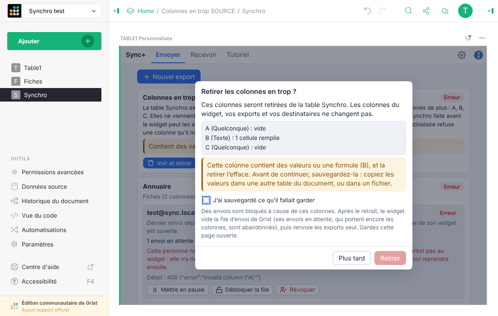
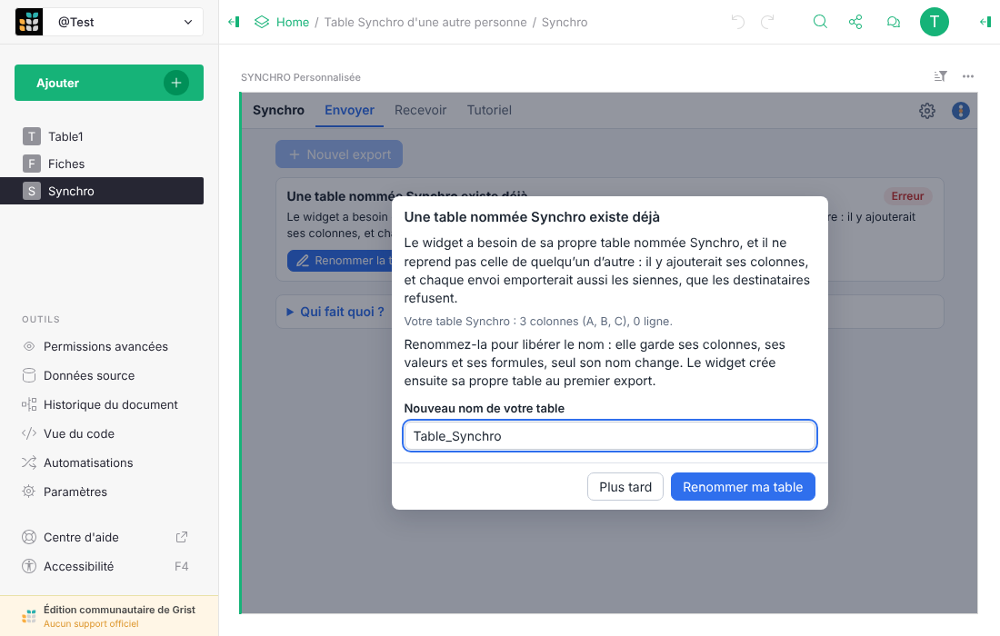
