# Tutoriel : brancher une synchro en dix minutes

Deux documents Grist de la même instance, dans un espace d'équipe :

- la **SOURCE**, qui a les tables à partager (ici `Contacts` et `Villes`) ;
- la **CIBLE**, qui en reçoit une copie tenue à jour (ici `Contacts`, et `Communes`, un
  référentiel qui existait déjà).

Il faut un **propriétaire** de la SOURCE et un **éditeur** de la CIBLE. Deux modes :

- **avec réponse** (recommandé) : ils échangent deux codes ; Grist pousse chaque modification vers
  la CIBLE, même quand personne n'a la page ouverte ;
- **lien public** : un seul code ; la SOURCE devient lisible par lien public, mais uniquement ses
  vues d'export (voir [plus bas](#mode-lien-public)).

Aucune donnée ne passe par les codes : seulement des noms de tables et de colonnes, et une
adresse d'écriture.

Les captures viennent du test d'intégration (`CAPTURES=1 npm run test:e2e`) : elles montrent
l'écran de la version du dépôt. Le même tutoriel, avec les captures, est dans le widget (onglet
**Tutoriel**) ; chaque étape des assistants en montre le morceau utile (**Aide en images**) et
**Qui fait quoi ?** dit ce que fait chaque document. Aux étapes où un code change de main,
**Copier avec les consignes** copie le code et les étapes de l'autre document, prêts pour un
courriel.

## 0. Installer le widget (dans chaque document)

**Ajouter**, **Ajouter une page**, vue **Personnalisée** (n'importe quelle table), **Ajouter une
page** ; **URL personnalisée**, coller l'adresse du widget, **Ajouter un widget** (Grist peut
demander de confirmer) ; dans le panneau de droite, accepter l'**accès complet**. Renommer la
page, par exemple « Synchro » : les tables techniques se rangeront dessous, repliées.

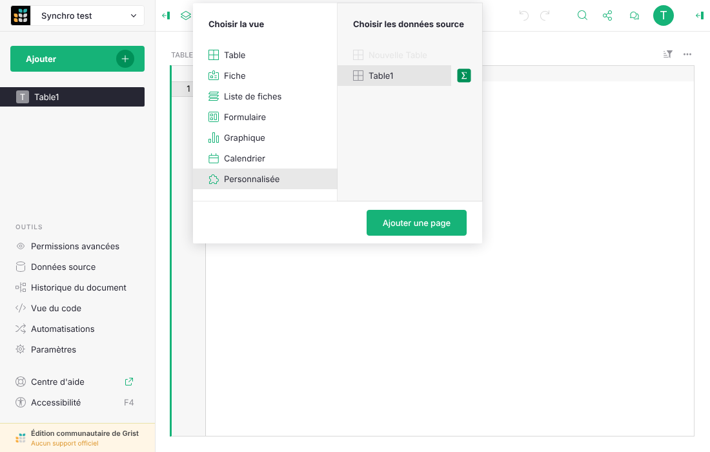
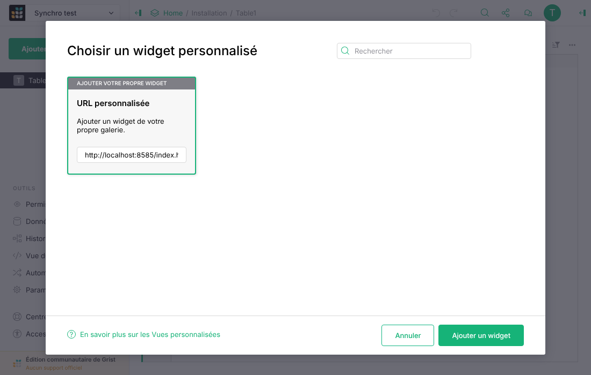
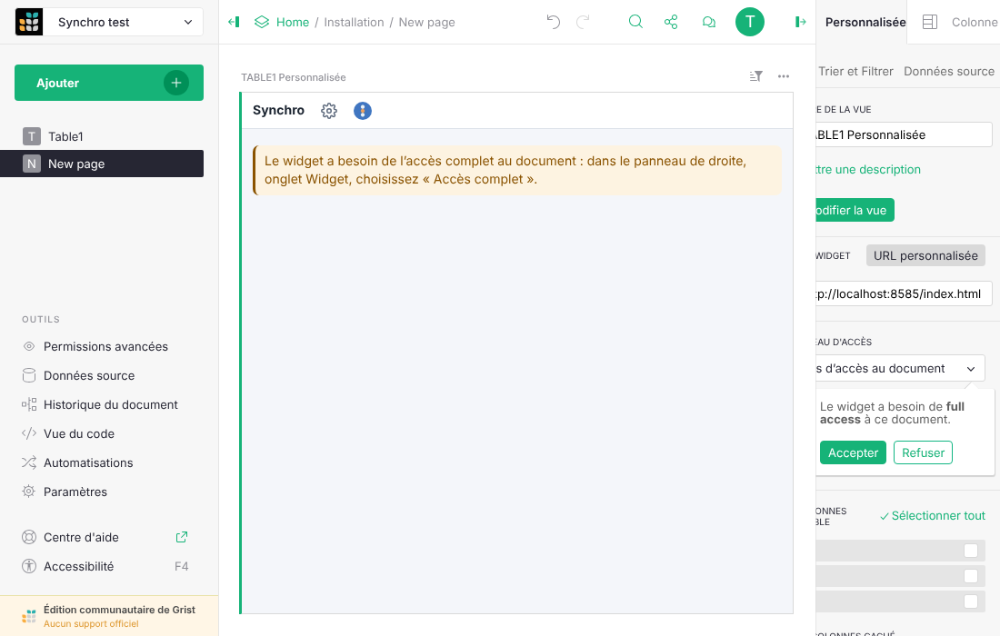

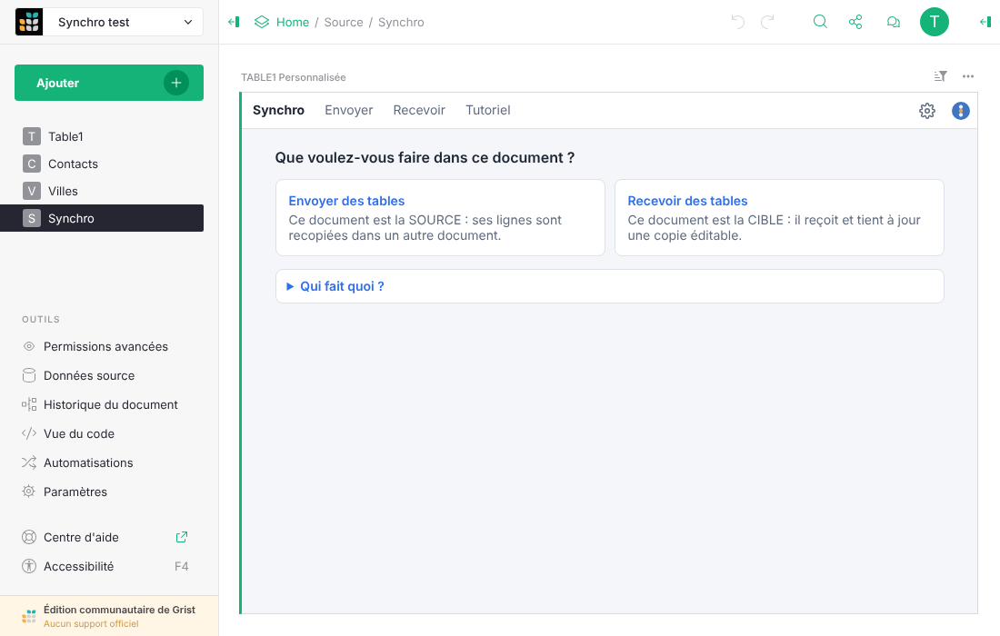

Au premier lancement, le widget demande le rôle du document. Ensuite il ouvre directement
**Recevoir** dans un document qui reçoit, **Envoyer** dans un document qui envoie.

## Côté SOURCE : inviter

### 1. Choisir les tables

**Envoyer**, **Nouveau destinataire**, cocher les tables à partager.

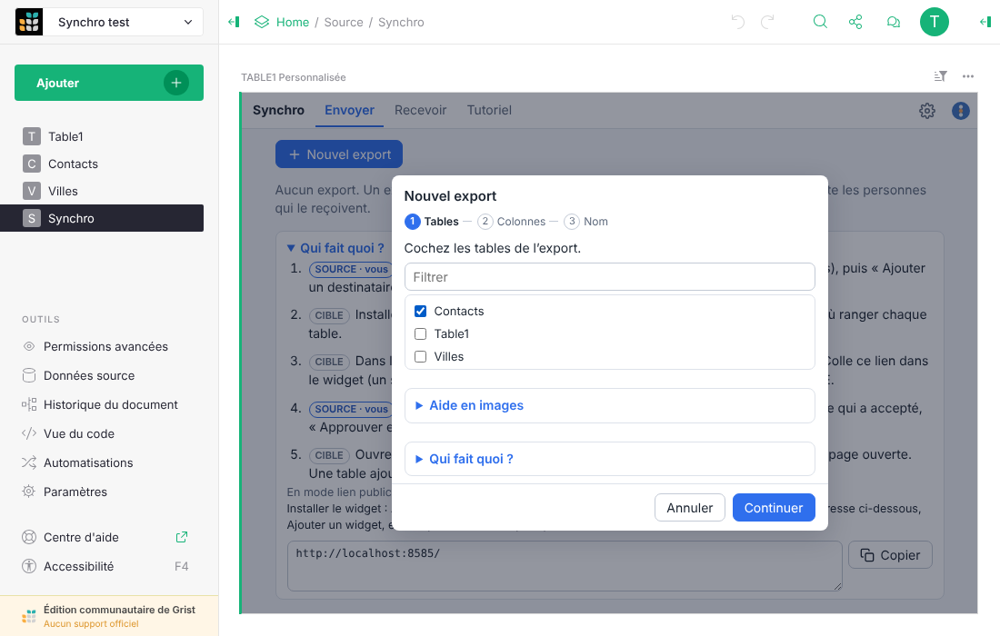

### 2. Choisir les colonnes

Cocher les colonnes qui partent (toutes par défaut). Le reste ne sort jamais du document : le
widget crée une **vue d'export** par table, tenue à jour par Grist, qui ne contient que ces
colonnes. Une Référence part comme le texte qu'elle affiche ; les pièces jointes ne partent pas.

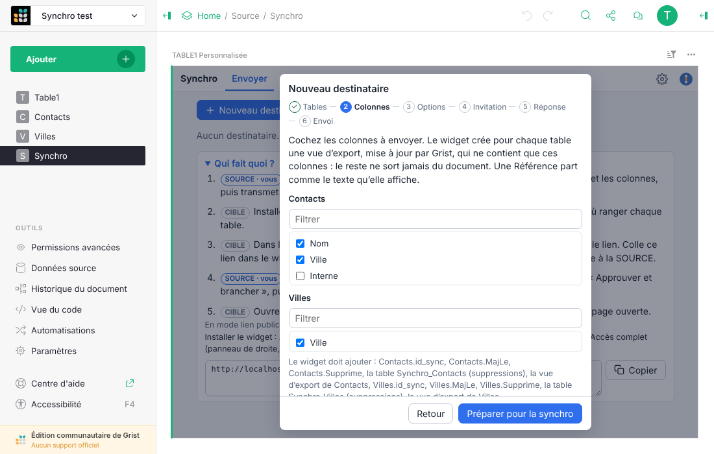

Le widget dit exactement ce qu'il ajoute, et ne le fait qu'au clic sur **Préparer pour la
synchro** :

- `id_sync` : identifiant stable de chaque ligne (les `id` de Grist sont réutilisés) ;
- `MajLe` : date de dernière modification, pour remettre les versions dans l'ordre ;
- `Supprime` : case à cocher pour retirer une ligne de la CIBLE sans l'effacer de la SOURCE ;
- `Synchro_<table>` : une ligne qui liste les `id_sync` existants, pour que les vraies
  suppressions partent aussi ;
- la vue d'export de la table.

Une table déjà envoyée garde les mêmes colonnes pour tous ses destinataires.

### 3. Options

Donner un nom à l'envoi : le destinataire le verra. Choisir le mode. Le **secret** (coché par
défaut) garantit que la réponse vient de quelqu'un qui a reçu l'invitation ; sans secret,
l'approbation repose sur la seule fiche du destinataire, que vous vérifiez à l'étape 9.

### 4. Copier l'invitation

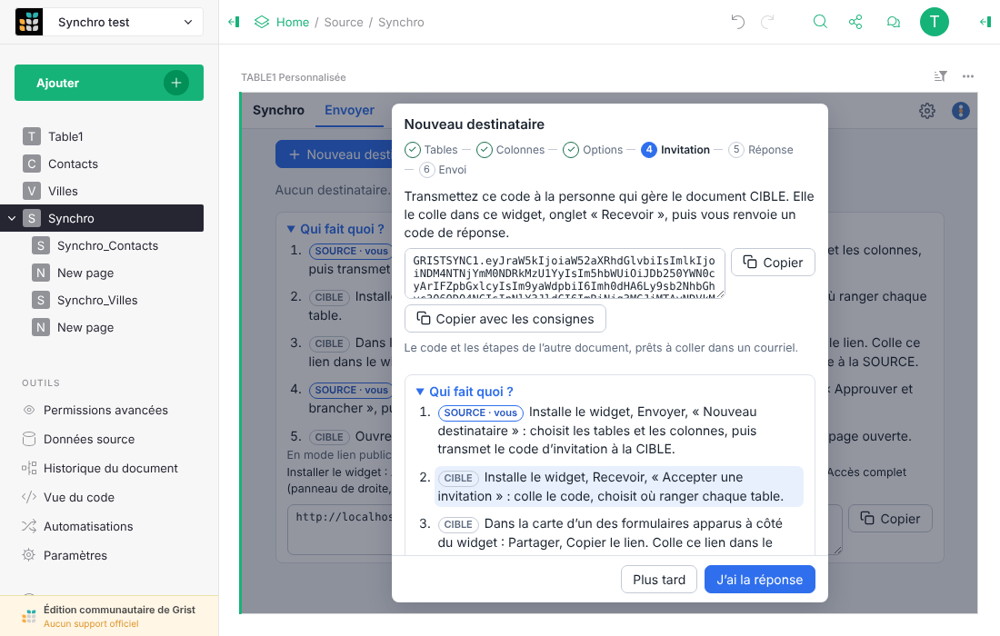

Envoyer ce code à la personne de la CIBLE. **Plus tard** ferme l'assistant : l'invitation reste
en attente sur sa carte.

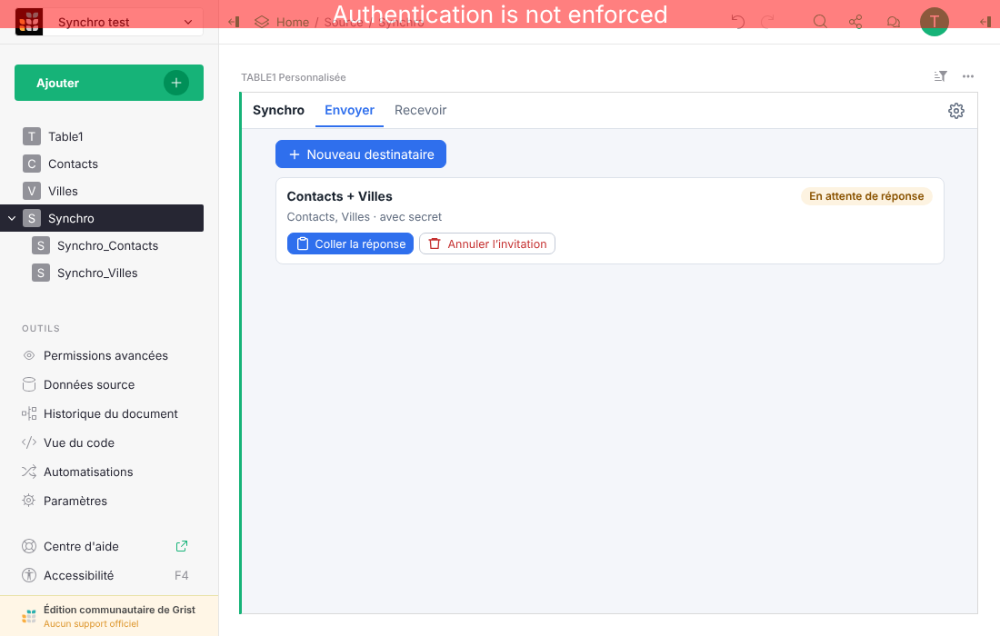

## Côté CIBLE : accepter

### 5. Coller le code

**Recevoir**, **Accepter une invitation**, coller le code.

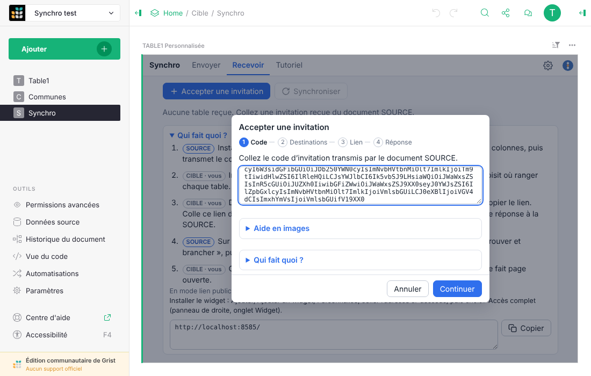

### 6. Choisir les destinations

Pour chaque table reçue, ouvrir la liste et choisir **Nouvelle table** (nom modifiable) ou une
table du document.

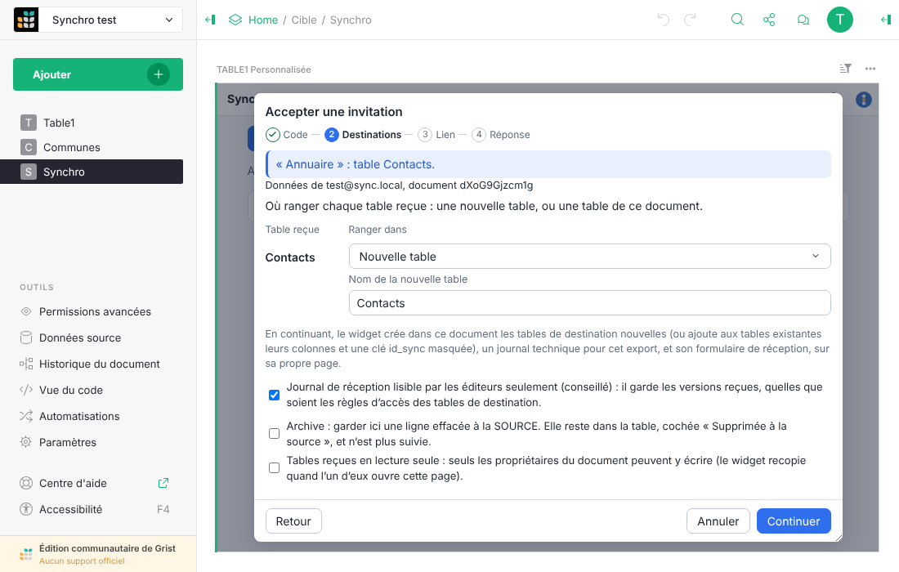

Pour une table existante, le widget demande où va chaque colonne envoyée (la même, une autre, ou
une nouvelle) et par quelle colonne **rattacher les lignes déjà là** : une ligne déjà présente
dont cette colonne a la même valeur qu'une ligne reçue est mise à jour au lieu d'être doublée.
Ici, `Ville` va dans `Commune`, et Lyon, déjà là avec une note, est rattachée.

Le widget crée un `Journal_<table>` par table (rangé sous sa page) et publie sur sa page un
formulaire de réception par journal. Grist recharge alors le widget : l'assistant se rouvre seul
à l'étape suivante.

### 7. Copier le lien du formulaire

L'assistant montre où cliquer : dans la carte d'**un** des formulaires apparus à côté du widget,
**Partager**, puis **Copier le lien** ; coller ce lien dans le widget, **Tester le lien**. Avec
plusieurs tables, il y a un formulaire par table, mais ils ont tous le même lien : un seul suffit,
celui de n'importe lequel.

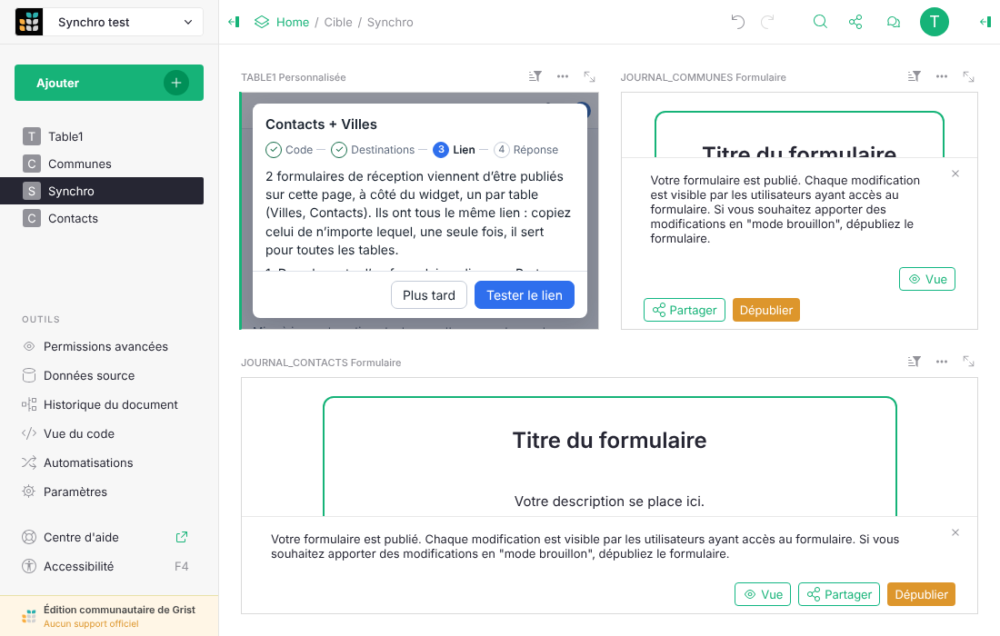

Ce lien est un **droit d'écriture** dans vos journaux : ne le diffusez pas ailleurs.

### 8. Renvoyer la réponse

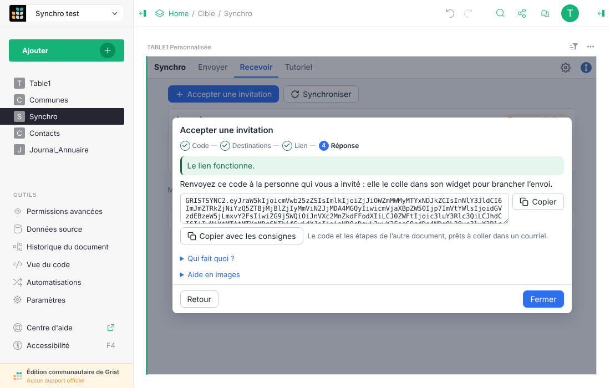

Copier le code de réponse et le renvoyer à la SOURCE. Il contient l'adresse d'écriture et votre
fiche (e-mail, document, équipe).

## Côté SOURCE : approuver

### 9. Coller la réponse

Sur la carte de l'invitation, **Coller la réponse**. Le widget montre qui a accepté et vers quelles
tables : vérifier que c'est la bonne personne, puis **Approuver et brancher**.

### 10. Envoyer les lignes existantes

Le branchement n'envoie que les changements à venir. **Envoyer** pousse les lignes déjà là.

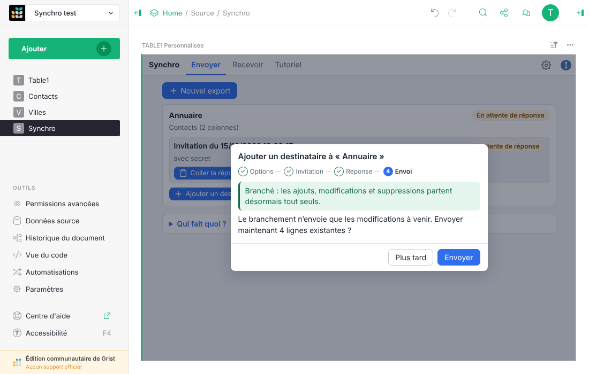

La carte du destinataire montre le dernier envoi reçu et les actions :

- **Tout renvoyer** ;
- **Colonnes** : ajouter ou retirer des colonnes à tout moment ; la CIBLE crée seule les
  nouvelles colonnes ;
- **Mettre en pause**, puis **Reprendre** : Grist n'envoie rien pendant une pause. À la reprise, le
  widget propose de **rattraper** (recommandé) : il renvoie seulement les lignes modifiées ou
  ajoutées pendant la pause, et la liste des clés pour les suppressions ; ou de reprendre sans
  rattraper ;
- **Débloquer la file**, quand un envoi échoue (Grist bloque alors toute la file du document
  environ 15 minutes) ;
- **Révoquer** : supprime les webhooks et, si plus rien n'envoie la table, propose d'effacer ses
  tables techniques.

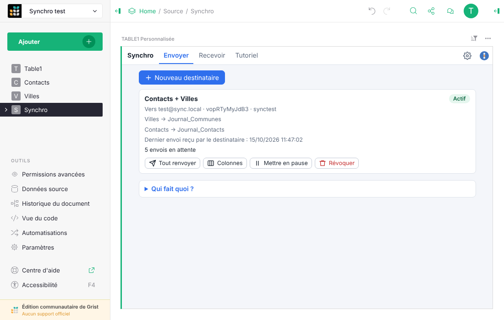

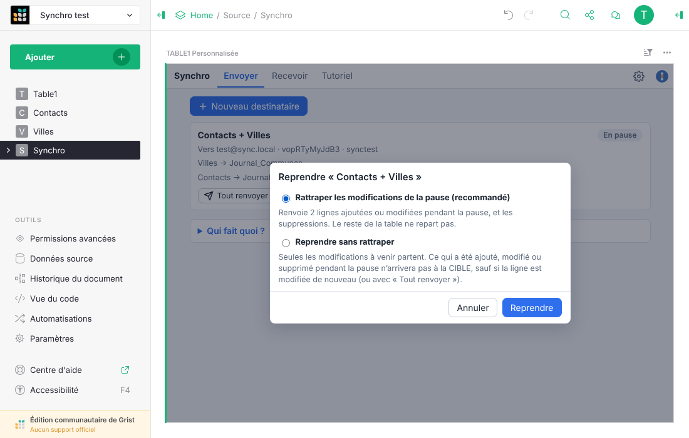

## Au quotidien, côté CIBLE

Chaque ajout, modification ou suppression dans la SOURCE arrive dans le journal en une seconde
environ, même si personne n'a le widget ouvert. La **recopie** dans la table de destination se fait
quand un éditeur ouvre la page du widget (même replié), puis toutes les 10 secondes tant qu'elle
reste ouverte. Une fois les données arrivées, les formulaires se replient en haut de la page.

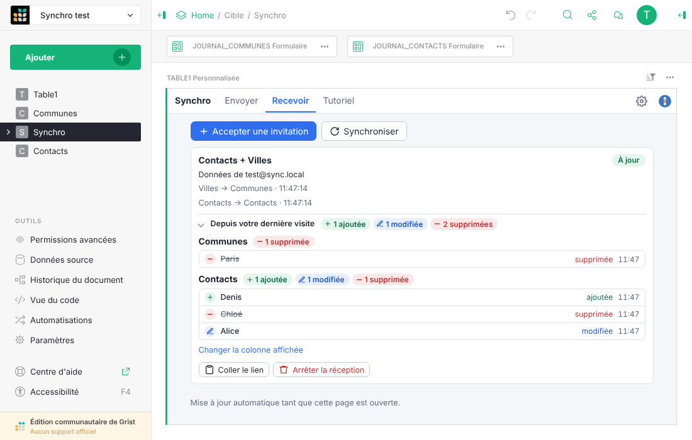

La carte montre le propriétaire des données, le dernier passage par table, et l'historique :
depuis votre dernière visite, par table, le nombre de lignes ajoutées, modifiées et supprimées,
puis les lignes elles-mêmes (20 au plus par table), nommées par la colonne de votre choix. Une retouche faite à la main dans la CIBLE reste en place jusqu'à la
prochaine modification de la même ligne dans la SOURCE. **Arrêter la réception** efface les
journaux et garde les tables de destination.

## Mode lien public

À l'étape 3, choisir **Lien public**. Le widget pose des règles d'accès : toute personne qui n'est
que **lectrice** du document, dont le lien public, ne voit plus que les vues d'export partagées.
Ensuite, dans le menu **Partager** du document, régler « Lien public » sur **Lecture**. La carte
passe de « Lien public à activer » à « Public ».

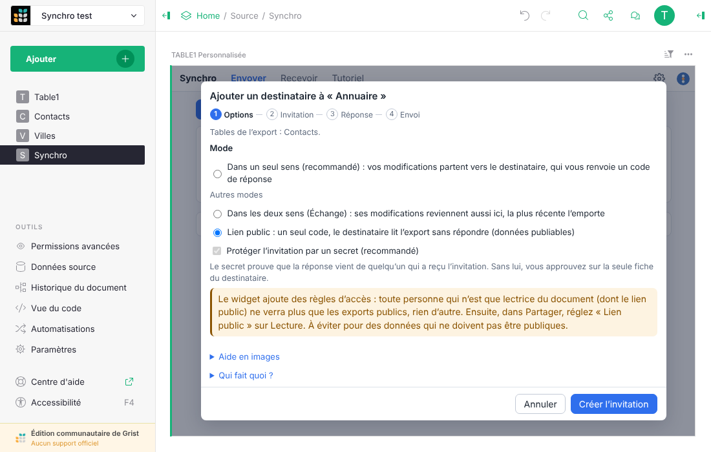

Côté CIBLE : coller le code, choisir les destinations, c'est tout. Le widget lit la SOURCE toutes
les 10 secondes tant que sa page est ouverte. À éviter pour des données qui ne doivent pas être
publiques ; les lecteurs déjà invités sur la SOURCE ne voient plus, eux aussi, que les vues
d'export.

**Révoquer** retire l'accès aux vues d'export. Tant que le lien public reste actif, le widget
garde la règle qui cache le reste du document : désactivez-le dans **Partager**.

## Si quelque chose coince

| Symptôme | Cause probable | Que faire |
|---|---|---|
| Rien n'arrive dans la table de destination | Personne n'a ouvert la page du widget dans la CIBLE | Ouvrir la page ; les versions attendaient dans le journal |
| La carte SOURCE est rouge | La CIBLE a arrêté la réception ou dépublié son formulaire | Révoquer, puis refaire une invitation |
| Tous les webhooks du document SOURCE sont en retard | Un envoi en échec bloque la file | **Débloquer la file** |
| Les lignes déjà présentes ne sont pas arrivées | Le branchement n'envoie que les changements | **Tout renvoyer** |
| Lien public : « n'est plus lisible » | Le lien public de la SOURCE est désactivé ou révoqué | Voir avec la SOURCE |
