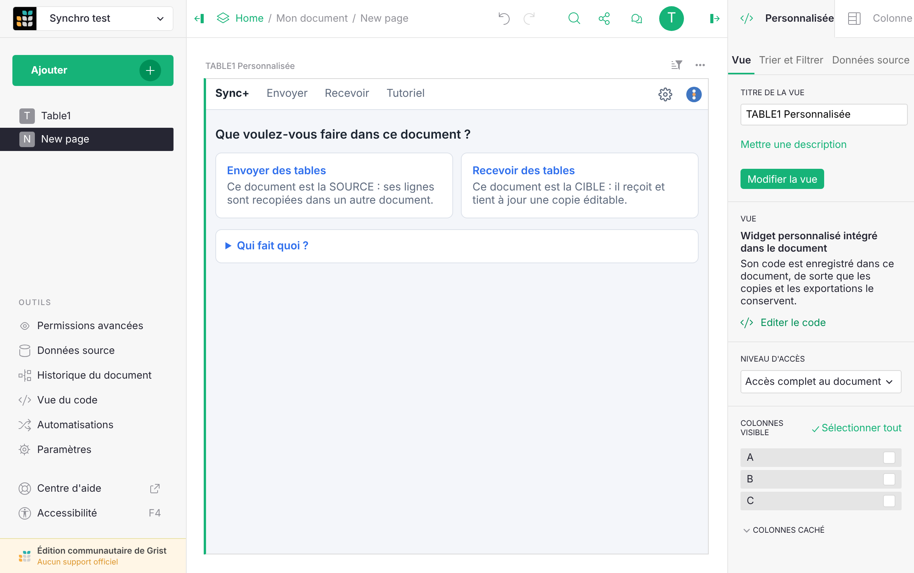
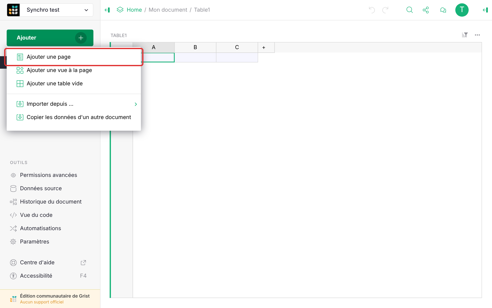
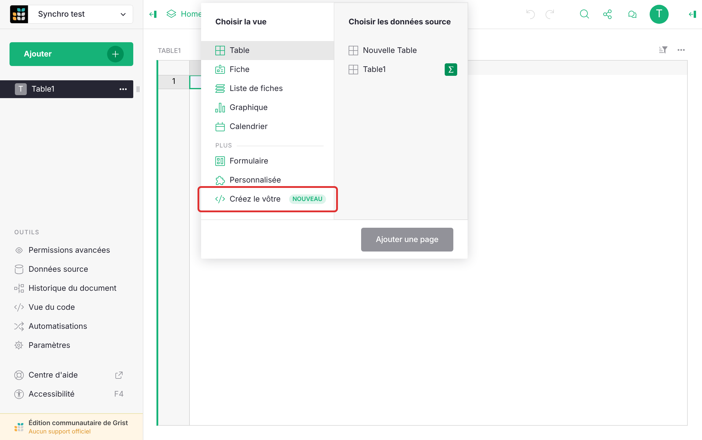
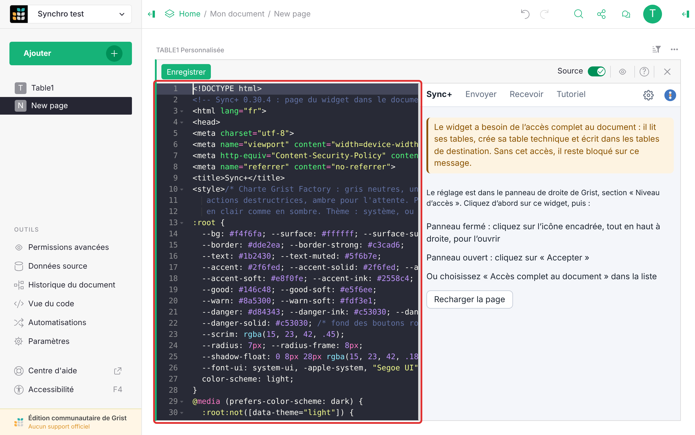
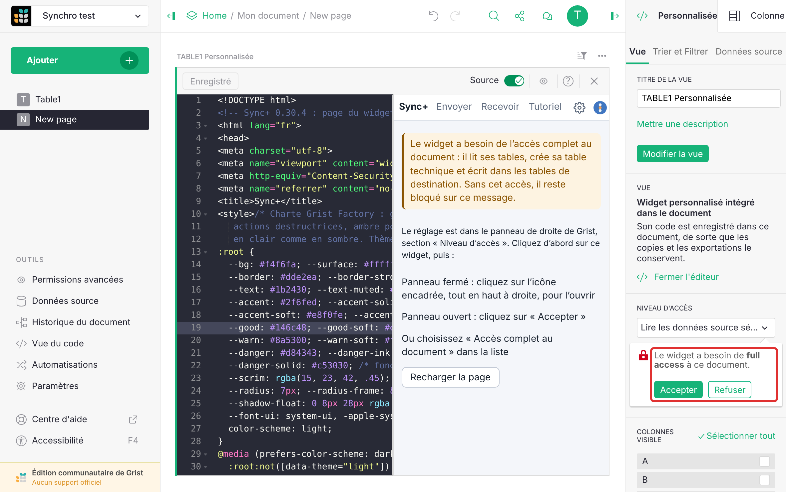

# The widget inside the document: nothing to host

*Version française : [`09-widget-dans-le-document.md`](09-widget-dans-le-document.md).*

Read this if **you have nowhere to publish static files**, or if you want the widget's code to **live in
the Grist document** (copies and exports of the document keep it). Grist can do this: it is the
**"Create your own"** choice, a widget whose code is written in the document. It needs **a single HTML
page**, which this repository can build.

If you can publish files on a server, [self-hosting](08-self-hosting.en.md) remains the most complete
route: everything this mode cannot do (see [what changes](#what-changes-compared-with-the-hosted-widget))
works there.



The guide follows the path: [before you start](#before-you-start), [1. build the page](#1-build-the-page),
[2. check it](#2-check-it), [3. paste it into Grist](#3-paste-it-into-grist), [4. webhooks](#4-the-instances-webhooks);
then [what changes](#what-changes-compared-with-the-hosted-widget), [the security of this mode](#the-security-of-this-mode),
[updating](#updating) and [if something does not work](#if-something-does-not-work).

> **Status**: this mode is **optional and recent**. It was tried in Grist 1.7.22 with a full path
> (export, invitation, reception, existing rows sent, a change received) and in Chromium only; what Grist
> changes in it from one version to the next is worth watching. The screenshots show the French interface
> of Grist.

## Before you start

You need:

- **the exact address of your instance**, for example `https://grist.example.org` (protocol, domain
  name, port if any; no trailing slash and no `/o/<team>`);
- a **Grist 1.7.11 or later** instance (the widget checks it when it connects) **that has the
  "Create your own" choice** (Add, Add a page: under "More"; seen in Grist 1.7.22); if it is missing, the
  instance is too old for this mode;
- Git and Node 20 or later, **on any workstation** (nothing is installed on the server);
- the right to **change the structure of the document** (owner, or editor if the instance allows it).

## 1. Build the page

```bash
git clone https://github.com/lombre33/grist-widget-one-way-sync.git syncplus
cd syncplus
git checkout <commit>      # the commit you reviewed
node builder/build.mjs --instance https://grist.example.org --compact --out syncplus-document.html
```

No dependency, no `npm install`: `builder/build.mjs` only reads the repository sources (`js/`, `i18n/`,
`css/`, `index.html`) and writes **one HTML file**. What it does, and only this:

1. it **orders the widget's modules** by their dependencies, and refuses a cycle;
2. it applies **seven fixed, named patches** (listed in `builder/build.mjs`, `patches`): the widget's
   address (and its name in the diagnostic), the widget API already loaded by the page, no "Add the widget
   to the page" button, no tutorial screenshots, two help images written into the page; plus your list of
   instances and the address used in the hand-over instructions if you give them. A patch whose text has
   disappeared from the repository **stops the build** instead of being ignored;
3. it writes the page with **its own security policy** (see [the security of this mode](#the-security-of-this-mode)).

The options:

| Option | Role |
|---|---|
| `--instance <origin>` | your instance (a bare https origin; `http://localhost:…` for a trial). Repeatable. **By default: the list in `js/config.js`**, i.e. the French State instance and docs.getgrist.com. |
| `--compact` | compressed modules (gzip, base64): **576 KB instead of 1.3 MB**. Unreadable by eye; Grist's REST API refuses more than 1 MB, Grist's editor accepts both. |
| `--widget-url <address>` | the address the widget quotes in its hand-over instructions (https, trailing slash); see [what changes](#what-changes-compared-with-the-hosted-widget). |
| `--lang fr\|en` | the starting language (by default, the browser's); it is not kept from one visit to the next. |
| `--out <file>` | the file written (by default `builder/dist/syncplus-creator.html`, ignored by Git). |

The build prints the number of modules, the size, the instances and **two SHA-256 fingerprints**: the
page's and its modules'.

## 2. Check it

The build is **deterministic**: the same sources and the same options give the same page, byte for
byte. Whoever has to approve the widget (a security officer) can therefore:

- **read** the code, which is the repository's (see [`SECURITY.md`](../SECURITY.md)), plus
  `builder/loader.js` (about 100 lines) and the patches of `builder/build.mjs`;
- **rebuild** the page from the same commit and compare the printed fingerprint;
- run `npm test`: `tests/unit/builder.test.mjs` checks that no module still quotes a relative address,
  that the security policy signs exactly the page's loader and styles, that the instances are the same in
  the code and in the policy, and that a booby-trapped origin (`https://a.org';`) is refused.

Note the page's fingerprint along with the commit: it is the **deployed version**.

## 3. Paste it into Grist

In each document that sends or receives data:

**1. Add a page** (the **Add** button at the top left).



**2. Choose "Create your own"** (under "More"), then a table (any: the widget has access to the whole
document), then **Add a page**. Grist opens the code editor.



**3. Paste the page**: open `syncplus-document.html`, copy **all** of its content (Ctrl+A, Ctrl+C), paste it into
the editor in place of what is there, then **Save** (or Ctrl+S). The widget appears to the right of the editor.



**4. Grant full access.** Like every widget from this repository, it needs **full access** to the
document (it reads its tables, creates its technical table, writes into the destination tables). In
Grist's right panel, **Access level** section, click **Accept**. The reason for this access and the
screenshots of the panel are in the [tutorial](04-tutoriel.md#0-installer-le-widget-dans-chaque-document).



**5. Close the editor** ("Close editor" in the right panel): the widget is there, like any other.

The rest of the path (export, invite, receive) is the [tutorial's](04-tutoriel.md). **In a new document**,
the first click on "New export" makes the widget set the access rules: Grist reloads the document and you
land on the widget's home screen again; click "Send tables" and "New export" once more (with the hosted
widget the wizard reopens by itself; here it does not, see [what changes](#what-changes-compared-with-the-hosted-widget)).

## 4. The instance's webhooks

Sends go through Grist's native webhooks: the instance must allow them towards itself
(`ALLOWED_WEBHOOK_DOMAINS`), exactly as for a hosted widget. See
[step 6 of self-hosting](08-self-hosting.en.md#6-allow-the-instances-webhooks); on
`grist.numerique.gouv.fr`, nothing to ask.

## What changes compared with the hosted widget

The widget **does the same thing**: same code, same sends, same wizards. What Grist's frame
(`sandbox="allow-scripts"`, an opaque origin, no storage, no windows) prevents it from doing:

| What changes | Why | What you see |
|---|---|---|
| **No preference kept** from one opening to the next | the frame has no `localStorage`; the widget keeps its preferences in memory, in `window.name`, which survives a reload of the frame but not of the document | the language starts again from the browser (or `--lang`); the news window is already marked as seen; **a wizard that should reopen after the access rules reload does not reopen**: click again |
| **No lock between tabs** | `navigator.locks` is of no use in this frame; the widget queues its tasks **inside the page** only | two tabs open on the same document each make their own pass (writes with no effect the second time, but the sending budget is not shared): open the widget's page in one tab only |
| **No channel between two tabs** | `BroadcastChannel` would reach nobody there | no "Send to a document open in this browser" button: you copy the codes |
| **Links do not open** | the frame may not open a window | the link to the other side's document and those of the help: copy the address (right click) or find the document in Grist |
| **No "Add the widget to the received table's page" button** | it needs a widget address, which does not exist here | add "Create your own" to the page you want and paste the page; one open widget is enough for the whole document, but **it only copies on an open page** |
| **Tutorial without screenshots** | they weigh 11 MB | the text is there, the images are not (the two help images for the form link are in the page) |
| **Hand-over instructions** | they quote the widget's address (`--widget-url`, by default the official one) | tell the other person to **paste the same page**, not to open an address |
| **Same version on both sides** | as always, but the version is frozen in each document here | a code from a newer version is refused ("The other document uses version …"): update both |

## The security of this mode

The deep guarantees are the widget's (see [`SECURITY.md`](../SECURITY.md)); this mode changes three of
them, in both directions.

**What is better.**

- **No server to protect or to trust.** Nothing is served: no compromised site, no cache, no domain, no
  certificate. The code you reviewed is the code that runs.
- **The frame is narrower** than a hosted widget's (which Grist shows without `sandbox`, on the widget
  server's origin): it is created with `sandbox="allow-scripts"` only. The page has no cookies, no storage,
  no access to Grist's page, no windows or forms. The "Copy" buttons work (Grist gives the frame
  clipboard writing).
- **The security policy belongs to the page** (a `Content-Security-Policy` tag, checked in Chromium):
  `default-src 'none'`; scripts: the page's loader (signed by its SHA-256 fingerprint), the `blob:`
  addresses that loader makes, and your instance's origin; requests: `blob:` and the instance only; styles:
  the page's stylesheet (signed); images: `data:` only; no base address, no form. Any change to the page
  changes the fingerprints: the build recomputes them, and `npm test` checks it.

**What is worse, or worth knowing.**

- **The code is in the document, so whoever can edit the widget can change it.** By default Grist gives
  editors the structure right: they can replace the pasted code with another, which would already have full
  access. This is also true of a hosted widget (an editor can change its address); the remedy is the same:
  **reserve structure changes for owners** (Advanced permissions, "Allow Editors to edit structure" unticked).
  What differs: there is no longer an address your security officer watches, the code is **in each document**.
  To check what a document holds, read it (in the editor, or through the API: table `_grist_Views_section`,
  column `options`, key `html`), save it to a file and compare its fingerprint (`sha256sum`) with the build's.
- **The policy allows the instance's whole origin for scripts**, not only `grist-plugin-api.js` as the hosted
  page does: the widget API is loaded by a relative address that Grist resolves itself, whose path is not
  fixed. The instance is what the widget trusts anyway (it sends it its requests, with full access).
- **The policy is in a `<meta>` tag**, for lack of a header: the browser applies it in the same way, except
  `frame-ancestors`, `sandbox` and reports, which do not work there (the frame itself is restricted by Grist).
- **Updates are manual**: the document keeps the pasted version, including in its copies and exports. Nothing
  tells you a newer version exists.
- **The list of instances is the page's**: it is written by `--instance` at build time (in the code and in
  the policy, in agreement), never read from a parameter, an input or the document.

## Updating

For each new version to take:

1. `git fetch`, read what changed (`git diff <old>..<new> -- js i18n css index.html builder`),
   `git checkout <new>`;
2. `npm test`, then the same `node builder/build.mjs …`: **new page, new fingerprint**;
3. in **each document**, open the widget's page, **Edit code** (right panel), replace everything
   (Ctrl+A, Ctrl+V), **Save**;
4. update **both sides** of a sync together;
5. note the new fingerprint.

Copies of a document keep the version it had when it was copied.

## If something does not work

| What you see | Probable cause | What to do |
|---|---|---|
| An empty screen, or "Sync+: loading failed (…)" in the frame | the pasted page is incomplete (cut copy) or damaged | paste the whole file again; open the browser console |
| "The widget cannot load Grist's API from …" | the page's instance is not the one that shows it: `--instance` forgotten at build time | rebuild with `--instance <your instance>` |
| Console: "Refused to load/connect…" | the instance is not in the page's policy | rebuild with `--instance` |
| The widget asks for full access and stays blocked | access was not granted | right panel, **Access level**, **Accept** |
| After "New export", you land on the home screen | Grist reloaded the document to set the access rules | click again; normal once per document |
| The REST API answers 413 when the page is set by a program | the page is over 1 MB | `--compact` |
| "This instance does not allow webhooks to its own address" | `ALLOWED_WEBHOOK_DOMAINS` | [self-hosting, step 6](08-self-hosting.en.md#6-allow-the-instances-webhooks) |
| "The other document uses version …" | different versions | bring both sides to the same page |

The widget's **Settings** page has a diagnostic button that copies the version, the browser and where the
widget is served from: here, "widget in the document".

## For development

`builder/README.md` describes the build and the loader. The test in a real Grist is
`tests/e2e/builder.mjs` (a fresh Grist and its environment file, see its header); this guide's screenshots
are redone by `node tests/tools/figures-widget-dans-le-document.mjs`.
