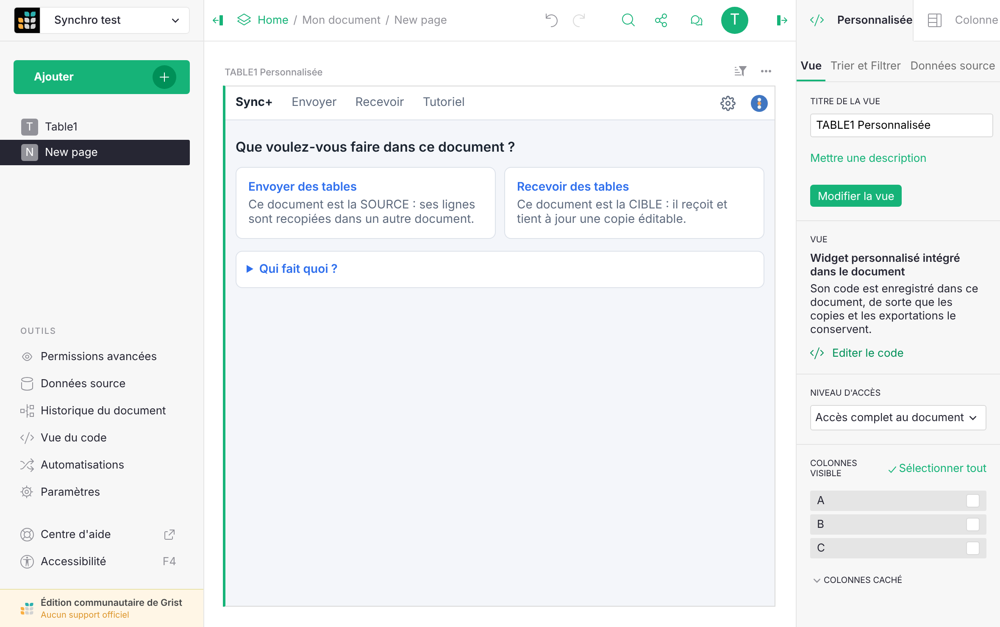
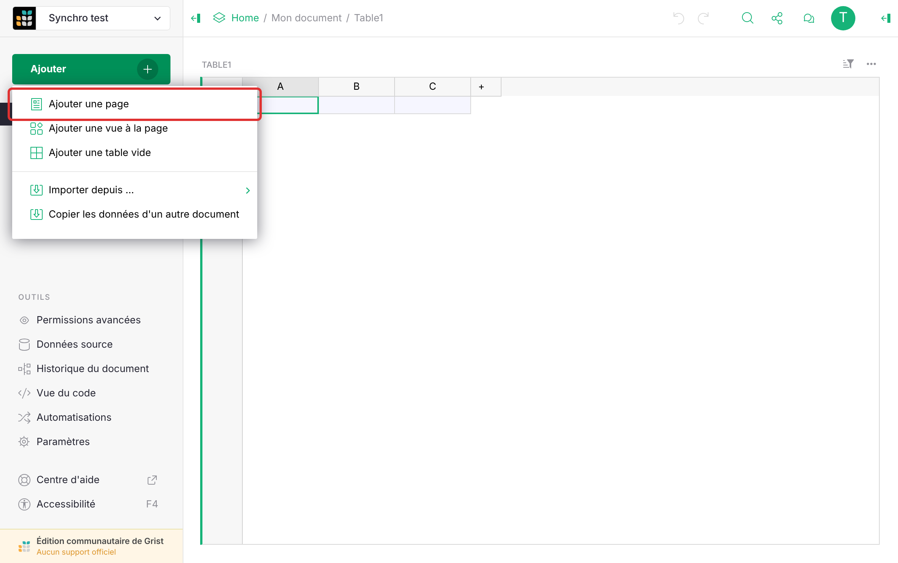
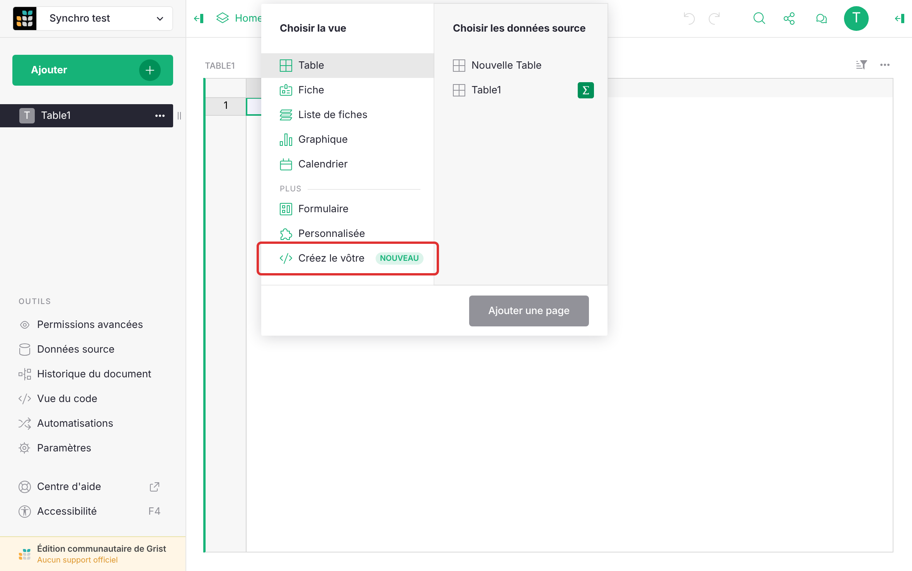
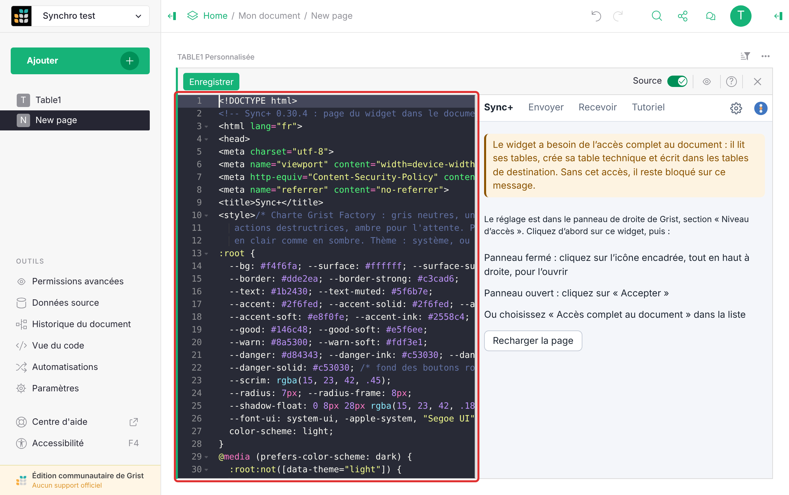
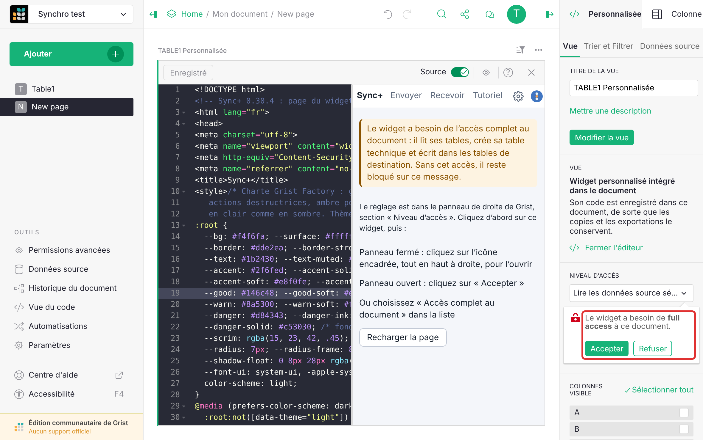

# Le widget dans le document : rien à héberger

*English version: [`09-in-document-widget.en.md`](09-in-document-widget.en.md).*

À lire si **vous n'avez nulle part où publier des fichiers statiques**, ou si vous voulez que le code
du widget **vive dans le document Grist** (les copies et les exportations du document le gardent). Grist
sait le faire : c'est le choix **« Créez le vôtre »** (en anglais « Create your own »), un widget dont le
code est écrit dans le document. Il demande **une seule page HTML**, que ce dépôt sait construire.

Si vous pouvez publier des fichiers sur un serveur, l'[auto-hébergement](08-auto-hebergement.md) reste
la voie la plus complète : tout ce que ce mode ne sait pas faire (voir
[ce qui change](#ce-qui-change-par-rapport-au-widget-hébergé)) y marche.



Le guide suit le parcours : [avant de commencer](#avant-de-commencer),
[1. construire la page](#1-construire-la-page), [2. la vérifier](#2-la-vérifier),
[3. la coller dans Grist](#3-la-coller-dans-grist), [4. les webhooks](#4-les-webhooks-de-linstance) ;
puis [ce qui change](#ce-qui-change-par-rapport-au-widget-hébergé), [la sécurité de ce mode](#la-sécurité-de-ce-mode),
[les mises à jour](#mettre-à-jour) et [si quelque chose ne marche pas](#si-quelque-chose-ne-marche-pas).

> **Statut** : ce mode est **optionnel et récent**. Il a été essayé dans Grist 1.7.22 avec un parcours
> complet (export, invitation, réception, envoi de l'existant, modification reçue) et dans Chromium
> seulement ; ce que Grist en change d'une version à l'autre est à surveiller.

## Avant de commencer

Il faut :

- **l'adresse exacte de votre instance**, par exemple `https://grist.exemple.org` (protocole, nom de
  domaine, port s'il y en a un ; ni barre finale ni `/o/<équipe>`) ;
- une instance **Grist 1.7.11 ou plus récent** (le widget le vérifie au branchement) **où le choix
  « Créez le vôtre » existe** (Ajouter, Ajouter une page : sous « Plus » ; vu dans Grist 1.7.22) ; s'il manque,
  l'instance est trop ancienne pour ce mode ;
- Git et Node 20 ou plus récent, **sur n'importe quel poste** (rien n'est installé sur le serveur) ;
- le droit de **modifier la structure du document** (propriétaire, ou éditeur si l'instance le permet).

## 1. Construire la page

```bash
git clone https://github.com/lombre33/grist-widget-one-way-sync.git syncplus
cd syncplus
git checkout <commit>      # le commit que vous avez relu
node builder/build.mjs --instance https://grist.exemple.org --compact --out syncplus-document.html
```

Pas de dépendance, pas d'`npm install` : `builder/build.mjs` ne lit que les sources du dépôt (`js/`,
`i18n/`, `css/`, `index.html`) et écrit **un seul fichier HTML**. Ce qu'il fait, et seulement cela :

1. il **range les modules** du widget dans l'ordre de leurs dépendances, et refuse un cycle ;
2. il applique **sept retouches fixes** (liste dans `builder/build.mjs`, `patches`) : l'adresse du
   widget (et son nom dans le diagnostic), l'API des widgets déjà chargée par la page, pas de bouton
   « Ajouter le widget à la page », pas de captures du tutoriel, deux images d'aide écrites dans la
   page ; plus votre liste d'instances et l'adresse des consignes si vous les donnez. Une retouche dont
   le texte a disparu du dépôt **arrête le build** au lieu de s'ignorer ;
3. il écrit la page avec **sa propre politique de sécurité** (voir
   [la sécurité de ce mode](#la-sécurité-de-ce-mode)).

Les options :

| Option | Rôle |
|---|---|
| `--instance <origine>` | votre instance (origine https seule ; `http://localhost:…` pour un essai). Répétable. **D'office : la liste de `js/config.js`**, c'est-à-dire l'instance de l'État et docs.getgrist.com. |
| `--compact` | modules compressés (gzip, base64) : **576 Ko au lieu de 1,3 Mo**. Illisible à l'œil ; l'API REST de Grist refuse plus de 1 Mo, l'éditeur de Grist accepte les deux. |
| `--widget-url <adresse>` | l'adresse que le widget cite dans ses consignes à transmettre (https, barre finale) ; voir [ce qui change](#ce-qui-change-par-rapport-au-widget-hébergé). |
| `--lang fr\|en` | la langue de départ (d'office, celle du navigateur) ; elle n'est pas gardée d'une visite à l'autre. |
| `--out <fichier>` | le fichier écrit (d'office `builder/dist/syncplus-creator.html`, ignoré par Git). |

Le build affiche le nombre de modules, la taille, les instances et **deux empreintes SHA-256** : celle
de la page et celle de ses modules.

## 2. La vérifier

Le build est **déterministe** : les mêmes sources et les mêmes options donnent la même page, octet
pour octet. Qui doit approuver le widget (un RSSI) peut donc :

- **relire** le code, qui est celui du dépôt (voir [`SECURITY.md`](../SECURITY.md)), plus
  `builder/loader.js` (environ 100 lignes) et les retouches de `builder/build.mjs` ;
- **reconstruire** la page depuis le même commit et comparer l'empreinte affichée ;
- lancer `npm test` : `tests/unit/builder.test.mjs` vérifie qu'aucun module ne cite une adresse
  relative, que la politique de sécurité signe exactement le chargeur et les styles de la page, que
  les instances sont les mêmes dans le code et dans la politique, et qu'une origine piégée
  (`https://a.org';`) est refusée.

Notez l'empreinte de la page avec le commit : c'est la **version déployée**.

## 3. La coller dans Grist

Dans chaque document qui envoie ou reçoit des données :

**1. Ajouter une page** (bouton **Ajouter** en haut à gauche).



**2. Choisir « Créez le vôtre »** (sous « Plus »), puis une table (n'importe laquelle : le widget a
accès à tout le document), puis **Ajouter une page**. Grist ouvre l'éditeur du code.



**3. Coller la page** : ouvrez `syncplus-document.html`, copiez **tout** son contenu (Ctrl+A, Ctrl+C), collez-le
dans l'éditeur à la place de ce qui s'y trouve, puis **Enregistrer** (ou Ctrl+S). Le widget s'affiche à droite de l'éditeur.



**4. Accorder l'accès complet.** Comme tout widget de ce dépôt, il a besoin de l'**accès complet** au
document (il lit ses tables, crée sa table technique, écrit dans les tables de destination). Dans le
panneau de droite de Grist, section **Niveau d'accès**, cliquez **Accepter**. La raison de cet accès et
les captures du panneau sont dans le [tutoriel](04-tutoriel.md#0-installer-le-widget-dans-chaque-document).



**5. Fermer l'éditeur** (« Fermer l'éditeur » dans le panneau de droite) : le widget est là, comme
n'importe quel autre.

Le reste du parcours (exporter, inviter, recevoir) est celui du [tutoriel](04-tutoriel.md). **Dans un
document neuf**, le premier clic sur « Nouvel export » fait poser les règles d'accès : Grist recharge le
document et vous revenez à l'accueil du widget ; cliquez de nouveau « Envoyer des tables », « Nouvel export »
(avec le widget hébergé, l'assistant se rouvre seul ; ici non, voir [ce qui change](#ce-qui-change-par-rapport-au-widget-hébergé)).

## 4. Les webhooks de l'instance

Les envois passent par des webhooks natifs de Grist : l'instance doit les autoriser vers elle-même
(`ALLOWED_WEBHOOK_DOMAINS`), exactement comme pour un widget hébergé. Voir
[l'étape 6 de l'auto-hébergement](08-auto-hebergement.md#6-autoriser-les-webhooks-de-linstance) ; sur
`grist.numerique.gouv.fr`, rien à demander.

## Ce qui change par rapport au widget hébergé

Le widget **fait la même chose** : même code, mêmes envois, mêmes assistants. Ce que le cadre de Grist
(`sandbox="allow-scripts"`, une origine opaque, sans stockage, sans fenêtres) l'empêche de faire :

| Ce qui change | Pourquoi | Ce que vous voyez |
|---|---|---|
| **Aucune préférence gardée** d'une ouverture à l'autre | le cadre n'a pas de `localStorage` ; le widget range ses préférences en mémoire, dans `window.name`, qui survit au rechargement du cadre mais pas à celui du document | la langue repart du navigateur (ou de `--lang`) ; la fenêtre des nouveautés est déjà marquée vue ; **un assistant qui devait se rouvrir après le rechargement des règles d'accès ne se rouvre pas** : recliquez |
| **Pas de verrou entre onglets** | `navigator.locks` ne sert pas dans ce cadre ; le widget met ses tâches en file **dans la page** seulement | deux onglets ouverts sur le même document font chacun leur passage (écritures sans effet la deuxième fois, mais le budget d'envoi n'est pas partagé) : n'ouvrez la page du widget que dans un onglet |
| **Pas de canal entre deux onglets** | `BroadcastChannel` n'y rejoindrait personne | pas de bouton « Envoyer à un document ouvert dans ce navigateur » : on copie les codes |
| **Les liens ne s'ouvrent pas** | le cadre n'a pas le droit d'ouvrir une fenêtre | le lien vers le document de l'autre côté, ceux de l'aide : copiez l'adresse (clic droit) ou cherchez le document dans Grist |
| **Pas de bouton « Ajouter le widget à la page de la table reçue »** | il a besoin d'une adresse de widget, qui n'existe pas ici | ajoutez « Créez le vôtre » à la page voulue et collez la page ; un seul widget ouvert suffit pour tout le document, mais **il ne recopie que sur une page ouverte** |
| **Tutoriel sans captures** | elles pèsent 11 Mo | le texte y est, les images non (les deux images d'aide du lien de formulaire sont dans la page) |
| **Consignes à transmettre** | elles citent l'adresse du widget (`--widget-url`, d'office l'adresse officielle) | dites à l'autre personne de **coller la même page**, pas d'ouvrir une adresse |
| **Même version des deux côtés** | comme toujours, mais la version est ici figée dans chaque document | un code venu d'une version plus récente est refusé (« L'autre document utilise la version … ») : mettez les deux à jour |

## La sécurité de ce mode

Les garanties de fond sont celles du widget (voir [`SECURITY.md`](../SECURITY.md)) ; ce mode en change
trois, dans les deux sens.

**Ce qui est meilleur.**

- **Aucun serveur à protéger ni à faire confiance.** Rien n'est servi : pas de site compromis, pas de
  cache, pas de domaine, pas de certificat. Le code que vous avez relu est celui qui s'exécute.
- **Le cadre est plus étroit** que celui d'un widget hébergé (que Grist affiche sans `sandbox`, sur
  l'origine du serveur du widget) : il est créé avec `sandbox="allow-scripts"` seul. La page n'a ni
  cookies, ni stockage, ni accès à la page de Grist, ni fenêtres ni formulaires. Les boutons « Copier »
  marchent (Grist donne au cadre l'écriture dans le presse-papiers).
- **La politique de sécurité est propre à la page** (balise `Content-Security-Policy`, vérifiée dans
  Chromium) : `default-src 'none'` ; scripts : le chargeur de la page (signé par son empreinte SHA-256),
  les adresses `blob:` que ce chargeur fabrique, et l'origine de votre instance ; requêtes : `blob:` et
  l'instance seulement ; styles : la feuille de la page (signée) ; images : `data:` seulement ; aucune
  base d'adresse, aucun formulaire. Tout changement de la page change les empreintes : le build les
  recalcule, et `npm test` le vérifie.

**Ce qui est moins bien, ou à savoir.**

- **Le code est dans le document, donc modifiable par qui peut éditer le widget.** Par défaut, Grist
  donne aux éditeurs le droit de structure : ils peuvent remplacer le code collé par un autre, qui aurait
  l'accès complet déjà accordé. C'est vrai aussi d'un widget hébergé (un éditeur peut en changer l'adresse) ;
  la parade est la même : **réserver la structure aux propriétaires** (Permissions avancées, « Autoriser
  les Éditeurs à modifier la structure » décoché). Ce qui diffère : il n'y a plus d'adresse que votre RSSI
  surveille, le code est **dans chaque document**. Pour vérifier ce qu'un document contient, lisez-le (dans
  l'éditeur, ou par l'API : table `_grist_Views_section`, colonne `options`, clé `html`), enregistrez-le dans
  un fichier et comparez son empreinte (`sha256sum`) à celle du build.
- **La politique autorise toute l'origine de l'instance pour les scripts**, pas seulement
  `grist-plugin-api.js` comme la page hébergée : l'API des widgets est chargée par une adresse relative que
  Grist résout lui-même, dont le chemin n'est pas fixe. L'instance est de toute façon ce à quoi le widget
  fait confiance (il lui envoie ses requêtes, avec l'accès complet).
- **La politique est dans une balise `<meta>`**, faute d'en-tête : le navigateur l'applique de la même
  façon, sauf `frame-ancestors`, `sandbox` et les rapports, qui n'y fonctionnent pas (le cadre, lui, est
  restreint par Grist).
- **Les mises à jour sont manuelles** : le document garde la version collée, jusque dans ses copies et
  exportations. Aucune alerte ne vous dit qu'une version plus récente existe.
- **La liste des instances est celle de la page** : elle est écrite par `--instance` au build (dans le code
  et dans la politique, d'accord), jamais lue d'un paramètre, d'une saisie ni du document.

## Mettre à jour

À chaque nouvelle version à reprendre :

1. `git fetch`, relire ce qui a changé (`git diff <ancien>..<nouveau> -- js i18n css index.html builder`),
   `git checkout <nouveau>` ;
2. `npm test`, puis le même `node builder/build.mjs …` : **nouvelle page, nouvelle empreinte** ;
3. dans **chaque document**, ouvrir la page du widget, **Éditer le code** (panneau de droite), tout
   remplacer (Ctrl+A, Ctrl+V), **Enregistrer** ;
4. mettre à jour **les deux côtés** d'une synchro ensemble ;
5. noter la nouvelle empreinte.

Les copies d'un document gardent la version qu'il avait au moment de la copie.

## Si quelque chose ne marche pas

| Ce qu'on voit | Cause probable | À faire |
|---|---|---|
| Un écran vide, ou « Sync+ : le chargement a échoué (…) » dans le cadre | la page collée est incomplète (copie coupée) ou abîmée | recoller tout le fichier ; ouvrir la console du navigateur |
| « Le widget ne peut pas charger l'API de Grist depuis … » | l'instance de la page n'est pas celle qui l'affiche : `--instance` oublié au build | reconstruire avec `--instance <votre instance>` |
| Console : « Refused to load/connect… » | l'instance n'est pas dans la politique de la page | reconstruire avec `--instance` |
| Le widget demande l'accès complet et reste bloqué | l'accord n'a pas été donné | panneau de droite, **Niveau d'accès**, **Accepter** |
| Après « Nouvel export », on retombe sur l'accueil | Grist a rechargé le document pour poser les règles d'accès | recliquer ; normal une fois par document |
| L'API REST répond 413 quand on pose la page par programme | la page dépasse 1 Mo | `--compact` |
| « Cette instance n'autorise pas les webhooks vers sa propre adresse » | `ALLOWED_WEBHOOK_DOMAINS` | [auto-hébergement, étape 6](08-auto-hebergement.md#6-autoriser-les-webhooks-de-linstance) |
| « L'autre document utilise la version … » | versions différentes | mettre les deux côtés à la même page |

La page **Réglages** du widget a un bouton de diagnostic qui copie la version, le navigateur et l'origine
d'où le widget est servi : ici, « widget dans le document ».

## Pour le développement

`builder/README.md` décrit le build et le chargeur. L'essai dans un vrai Grist est
`tests/e2e/builder.mjs` (un Grist neuf et son fichier d'environnement, voir son en-tête) ; les captures de
ce guide se refont par `node tests/tools/figures-widget-dans-le-document.mjs`.
